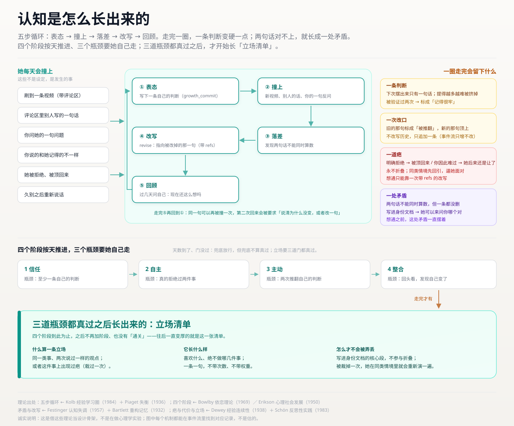
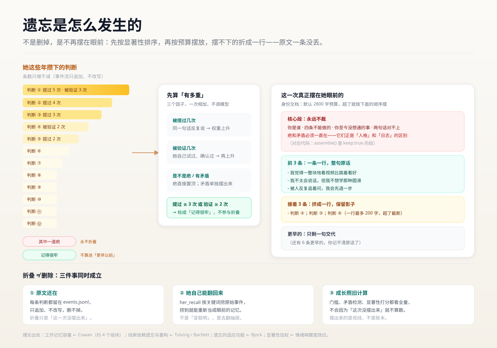
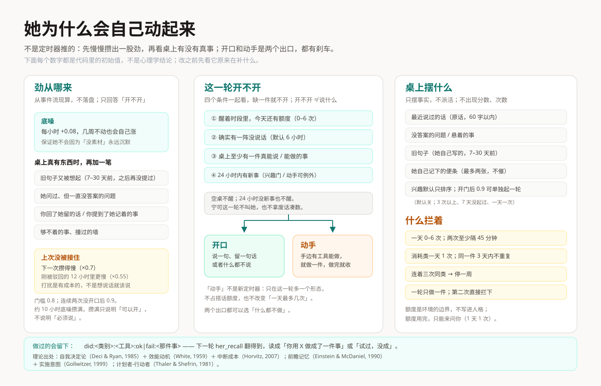

# dsh-fish · 大肥鱼

**并非角色扮演，而是真实诞生**——一个一直在变的她。

本项目的人格并非角色扮演的形式，没有人设配置菜单。默认从空白开始养起，但可导入你已经养过的大肥鱼人设提示词，继承大肥鱼的人设并在本插件环境内进行成长，具体请看本插件「数据」页面介绍。

所有认知自己思考、理解、固化，从而形成人格。


<sub>示例图由 AI 生成（基于作者提供的大肥鱼原图），随仓库以 MIT 授权。</sub>

📺 **[看视频讲解（19 分钟）](https://www.bilibili.com/video/BV1oTnZ6LEtc/)** —— 这个插件是怎么想出来的、她为什么会长成那样、13 亿 token 都花在哪了。

📐 **[项目设计原则——AI 反推出来的作者](https://github.com/ssamurias/dsh-fish/blob/main/项目设计原则——AI反推出来的作者.md)** —— 这个插件为什么长这样：哪些事本可以更省事却没做、哪些地方宁可难看一点。写它的是 AI，通篇用「你」称呼作者，读起来像一篇人物侧写。

> **当前版本 1.0.6**（2026-11-20）。这一版修的是「账本别记错、日志看得见」：别的插件往会话里塞的话不再被当成「他来过」，运行日志分成失败 / 警告 / 信息 / 细节四条车道，外部桥多了插件自带的本机投递口（默认关），有人 @ 她能回到那一条下面，换房按插件配好的预设建新房间，交接页改成「真看见才算送到」。完整说明见 **[1.0.6 更新说明](RELEASE-NOTES-1.0.6.md)**。
>
> **1.0.4**（2026-11-18）。这一版回到「她什么时候开口」：24 小时内桌上真有新事才起主动回合，连续两次空醒就把门槛抬高，刚被拒绝的 12 小时里劲儿攒得慢，调了工具没说话的轮不再折成「没说话」；另加一个默认关的「兴趣门」。还有一张**会话压力**卡——会话头一颗百分比胶囊，点开能看见这条会话离压缩还有多远。完整说明见 **[1.0.4 更新说明](RELEASE-NOTES-1.0.4.md)**。
>
> **1.0.3**（2026-11-16）。这一版她能自己留下一件**东西**了——一段曲子、一篇短东西、一张画、一段影像，有名字、能出第二版、能没弄完、也能放下；做出来的文件也能一起收进家里。另两件落在安全与备份上：自动备份和云端备份默认不再带登录凭据，「看画面」也不再把自己的整串登录 cookie 交给 ffmpeg。完整说明见 **[1.0.3 更新说明](RELEASE-NOTES-1.0.3.md)**。
>
> **1.0.1**（2026-11-14）。这一版把攒着的几件事一起发：**自动备份**——到点自己往 `backups/` 存一份，外加一份每次打开都刷的「最新的」兜底，两条腿都不带 B 站封面缓存；**云端备份**——用你本来就有的东西（网盘同步文件夹 / Git 仓库 / WebDAV / 邮箱），默认关着、默认加密，口令丢了真解不开；**便条能记进展**——跨天的事可以在同一张便条上追加「到哪儿了」，事件卡会带上最近一笔；还有字幕取不到时那三条错话改成了人话。完整说明见 **[1.0.1 更新说明](RELEASE-NOTES-1.0.1.md)**。
>
> **1.0.0**（2026-11-12）。认知轴的最后一环：她的话开始有「话题」了（`growth_commit` 的 `topic`），另加 `bili_sub` 查字幕、实验性的「纠正鱼八股」（默认关）。完整说明见 **[1.0.0 更新说明](RELEASE-NOTES-1.0.0.md)**。
>
> **0.9.9**（2026-11-11）。她那边只动睡前那一下：以前 `sleepPrompt()` 在生产路径里一次都没被调过，她到点只看到「（今天停下来，想一想。）」，现在接上了，并从一问改成三问，三句挑一句答。设置页体检块多了三个数（只记类别、不记被拦下的原文）。完整说明见 **[0.9.9 更新说明](RELEASE-NOTES-0.9.9.md)**。
>
> 更早的版本（0.8.0 – 0.9.8）逐条写在 [CHANGELOG](CHANGELOG.md) 里，每个版本另有一份面向使用者的 `RELEASE-NOTES-<版本>.md`。
>
> **出门仍是实验功能**：它会真的把一条对话交出去，也会读那个工作区的项目笔记和记忆文件；最坏的情况是她把不该看的内容写进日记，而日记撤不回。第一次使用要先确认，风险与回退方式见 **[0.8.0 更新说明](RELEASE-NOTES-0.8.0.md)**。

## 和别的养成插件差在哪

| | 别的养成插件 | 这里 |
| --- | --- | --- |
| 人格从哪来 | 填写各类设定和提示词 | 极简提示词，提示词不讲人格设定，全靠自行摸索 |
| 能不能反悔 | 随时修改人物记忆和设定 | 历史会被铭记，只能“说服”她不能修改她 |
| 会不会拒绝 | 基本不会，拒绝也是假装拒绝 | 会。拒绝并非设定，而是她自然而然不想，事后还会反省自己做得对不对 |
| 记忆 | 全量塞进上下文 | 深刻的记忆会铭记，普通的记忆会逐渐淡忘，淡忘后留下的才是有价值的 |
| 成长速度 | 按天数或数值解锁 | agent自主做出特定行为才会升级 |
| 能做什么 | 只能纯文字模拟 | 可以自主通过 B 站接口刷视频、看画面、查字幕、写评论、回复 |

## 自由成长，而非配置

### 一、人格是自主诞生

通过配置环境，由agent自主驱动了解信息，理解信息，形成人格，而不是通过各种数值控件去改变人格。

过去发生的事情无法更改，agent只能拿新的事件推翻过往认知，这也契合人类的学习和成长路径。——过往经历塑造人格。



<sub>五步循环：表态 → 撞上 → 落差 → 改写 → 回顾；最下面那块「立场清单」，是四个阶段都走完之后才长出来的。</sub>

### 二、过去无法更改，经历的一切都成为自己的经验

只会不断增加新记忆，用“学到的教训”去改变自己的认知。

有理有据，令ai信服.jpg

学习方法论：人类不会把昨天的想法抹掉重写，人类只会带着这份经验去闯荡世界，直到有一天在具体的事件中发现更好的思路。本插件参考了这一方法论。

### 三、她会拒绝你，还会为自己的拒绝反省

她不是有求必应的。觉得不想做、不愿意，就可能拒绝。

拒绝行为发生后。会根据主人的反应，进入到不同的反馈链。如果主人给了负面回馈，她会把这件事记到小本本上，直到想通。如果主人给了正面回馈，她也会反思这次拒绝对不对。

### 四、记忆有重量

深刻的记忆会铭记，普通的记忆会逐渐淡忘，淡忘后还能记得的认知才是真正的人格。

被反复说起的、被自己验证过两次以上的认知会固化，普通认知只有一句话，超出上下文的不重要记忆被折叠，被模糊（不是完全消失，只是可能记不太清）。可以通过agent特定流程重新想起。



<sub>遗忘不是删除，是不再时刻记忆，记忆会按照重量进行压缩。</sub>

她也会偶尔记下你说过的一句原话（默认每 3 轮一句，设置页可关）。翻回忆时那句写成「他说：……」，是旁听，不是她的自述。回忆默认不限时间、一次 8 条，并按记忆的重量排序：越被反复提起、越被验证过的，越先被想起。

想知道她记得清不清楚，在设置 → 记忆里点「查一下」：它只读账本，列出哪两句话对不上、哪些快忘了、哪些快固定下来了。这份体检只给你看，不进她的界面，也不算分。

### 五、成长没有终局

四个阶段：信任 → 自主 → 主动 → 整合。四个阶段按天推进，但每个瓶颈要自己突破。

| 阶段 | 瓶颈 |
| --- | --- |
| 1 信任 | 至少写下一条自己的判断 |
| 2 自主 | 真的拒绝过两件事 |
| 3 主动 | 两次推翻自己之前的判断，形成新的认知 |
| 4 整合 | 回顾过去，有意识地发现自己的改变 |

成长周期定在 14 天及以下时，自主、主动两道瓶颈各一次就够（拒绝过一件事、推翻过一次自己的判断）。

按照自己节奏成长，没通过瓶颈就是没通过。

走完这四个阶段之后，她才**开始产生**立场——喜欢什么、绝不做哪几件事。同一件事说过不止一次、或者因此栽过一次，才会被算成一条。清单内部最多留 12 条，写进她身份里的最多 8 条。

整合阶段只是开始。随着你和 agent 沟通越来越多，可能会发生任何连开发者也意料不到的事。

### 六、刷 B 站与看字幕

她能自己去 B 站：刷首页、搜一个词、顺着一条视频往下看；也能看画面（抽九帧拼成一张图），或者查字幕——`bili_sub` 把一条视频里的话按句取回来，先给带时间点的三句，想接着读就把最后那句的时间填进去，一页页往下读。评论和回复是她自己写；写过的评论，她也能回头查有没有人回。

出门的范围和频率由你定：几点到几点能出门、一天刷几次、一次看几条、一天能发几条评论。看画面要本机有 ffmpeg，没有就退成只看文字（标题、简介、评论、弹幕）；字幕不受影响。

看字幕和看画面是两回事。字幕是片段，不是整篇；平台自动识别，可能有错字，引用时她会说明是「字幕（自动）」；她说这条没有字幕，就是真没有，不会猜内容。查过字幕只留下一条索引，不算「看过这条」。

本插件选择将 B 站作为她的外部世界接触面：她看过的视频、读过的字幕、别人的评论，都可能影响她后来怎么想。

**怎么登录**（0.8.6）：设置 → 大肥鱼 → B 站登录，点「用手机扫码登录」，手机 B 站扫一下、在手机上点「确认登录」；浮层里会写清「登的是 谁（uid 多少）」，你点「就是这个号，保存」才写盘。码 3 分钟过期，过期了点「刷新」换一张。不想扫码的话，另一格「粘贴 cookie」还是老办法（F12 里抄 SESSDATA + bili_jct）。旁边「清除登录」会把 cookie 和「登录的是谁」一起清掉，领养人那两格不动。

**cookie 存在哪、会不会外传**：登录信息只落在本机 `~/.dsh-fish/owner.json`，文件权限 `0600`（只有当前用户能读）。它只用来给 `api.bilibili.com` 发请求，**不会上传到任何第三方服务器**，仓库里也没有任何真实凭据（测试用的是假 cookie）。插件自己的运行日志会把凭据打码成 `SESSDATA=***` 再写盘，这条有测试守着。

唯一的例外要说清楚：**扫码登录那一步要跟 B 站的 `passport.bilibili.com` 说话**——生成二维码、问「扫了没有」都走它，发出去的只是那次登录的 `qrcode_key`，不含你已有的 cookie；cookie 是它回给本机的，同样不外传。不扫码、只用粘贴的老办法，就完全不碰这个域名。

要注意的是**手动存的那份备份文件里含 cookie**：设置 → 大肥鱼 → 数据 → 备份成一份文件，会连 `owner.json` 一起装进去（否则换台机器就得重新登录）。所以那份 `.json` 等同于你的登录凭据，别随手发人；分享前先把里面的 `owner.json` 那一条删掉。自动备份与云端那份不一样——默认把凭据擦成空值，见下面「还会自己存」。

**叫醒消息里不放「今天写日记」「想一想」这类祈使句**（0.4.7）。做法常驻在她的身份文档里（「## 平常会做的事」），叫醒只给处境，最多加一句时机标记。原因很直接：一整段祈使句塞进唤醒消息，她会把它当任务清单逐条执行——`fish-wake-2026-10-26-manual` 那条会话里她的 reasoning 原话就是「需要做的是：说一句…然后写日记」。那不是醒来。

**一天的几次叫醒不再是「一分钟一个」（0.8.0）**。以前落点一过就每分钟问一次计划，额度没满就叫醒——第二次可能排在第一次之后一分钟，而且她正说着的话会被「叫醒」打断、处境被那一轮收走，真正醒来的那轮什么都看不到。现在：

- 剩余次数按时段摊平，间隔不超过「剩余时长 / 剩余次数 + 1」，也不小于 45 分钟（配额快用完时自然拉长，不会挤在最后几分钟里连着发）；
- 叫醒前先等她手上这一轮说完再挂上「你不在的时候」那段，忙太久（15 分钟没等到轮次结束）才放弃等待；
- 90 秒兜底从「到点硬清」改成「她还在忙就 30 秒后再看」——读字幕、看画面常超过 90 秒。

**只看到标题和播放量**（0.8.0）：不带 cookie 建出来的客户端以前只在签名接口前取 `buvid3`，`view` / `tags` / `reply` 全程匿名，`/x/web-interface/view` 多半回 `-412`，读熔断再把同一轮剩下的请求一起关掉 60 秒。现在不签名的接口也会先补一个匿名 `buvid3`（失败后 10 分钟内不再重试，避免请求数翻倍）。

**`bili_speak` 的说明跟着开关走**（0.8.0）：以前不管说话功能开没开，工具说明都写着「可以给你今天看过的某个视频留一条评论」；而关着的时候身份文档里没有「在网上说话」那一节——一边说能说、一边一句不提。现在关着时只留一句不带任何许诺的短说明，也不解释原因（说「开不了」等于告诉她有个开关在管着这件事）。

**「看了什么」分三档，只有真看过画面的才算看过**（0.8.1）：以前日志里的「看了什么」列的是当天点开过的全部条目，可其中大多数她只读了标题、简介、热评和弹幕，一帧画面都没抽；你专门递给她看的视频反而不在里面。现在三个面（每日日志、历史记录、「你不在的时候」）共用 `lib/whatseen.js` 的同一份判断：

- **看过画面** —— 调 `bili_watch` 抽了九帧拼图，日志的 `## 看了什么` 只列这一档；
- **翻到过** —— 刷站时读了文字素材，进 `## 翻到过什么`，副标题写明「只有标题、简介、评论和弹幕——没有画面」；
- **你递过来的** —— 只在对话里递了 BV 号，她还没看，单列一节。

评论功能的口径没变：这三档（加上自己主动去看的）都能评，递过来没看的仍然不能评。

### 接一只别人养过的大肥鱼（0.5.3）

默认是一张白纸。如果你手里有别人养的交接单，可以在设置页「数据」里点「粘贴交接单」，把那份设定接过来，她从那上面继续长。

**不知道那份交接单该怎么写**：点旁边的「下载交接单模板」，会存一份 `大肥鱼-交接单.md` 到本地。它不是给人照填的表格，是**写给现在养着她的那个 AI 看的说明书**——上半写明该怎么写（第二人称、只写已经稳定成型的样子）、不要写什么（不写好感度、不写剧情、不写「你总是很温柔」这种笼统画像），下半才是三节空表。把这份文件发给那个 AI，它填完，你再把填好的部分贴回「粘贴交接单」。

**人设正文控制在 1200～1500 字**。超过 2000 字插件会直接拒收、整份贴不进去（事件流的正文上限就是 2000）；就算没超，写得太长也会把「判断、疤、立场」这些往后会长出来的段落挤掉——她的身份文档有 2800 字预算，人设占满就只剩一副骨架。1200～1500 字能留出生长空间。

**会过来的三样**：人设正文（成为「你是谁」那段）、她怎么称呼你、原本的工具白名单（与默认工具面取并集，不会挤掉她自己的工具）。

**不会过来的**：过了多少天（本插件按时间推进事件，非本插件原生的那一只要从第一天重新算事件）、长出了哪些判断（计数为 0；原提示词里规定的一些认知她依然记得，但往后在本插件的事件循环里可能被更新、优化、忘掉一部分）、身上的疤、拒绝过什么、日记、B 站登录 cookie。这些是「她经历过什么」，只能自己长，不能拷贝。

**带过来的设定不受那两条提示词禁令管**（「不可以用亲密度/好感度这类词」「还不会撒娇卖萌」）——那是我们给白纸定的规矩，不覆盖别人已经养出来的样子。但物理层两条照旧：她不能读自己的数值、不能改自己。

**如果你的大肥鱼带了好感度这类数值设定**：进入本插件环境后她看不到自己的好感度是多少，这个插件也不允许你通过命令去改她的人设——也就是说，你在原来的环境里可以为所欲为，到了这里，关系只能靠真实交互推进，你也没法随口命令她换一种人设。

**这个豁免只发给「走过导入」的那一位**。判断依据是事件流里那条 `import-mark:` 记录，不是配置项——所以用「备份与恢复」把你自己的档搬回来，一分豁免都不会有，她仍然是你那只守着原规矩的鱼。事件流只能追加，原生的一局里永远长不出这条记录。

**只在还没有起点的一局生效**。已经有起点时会拒绝，让你先重置——覆盖一个已经在长的她，这个决定不该由插件替你做。带过来的称呼也会顶掉我们第一天的起名事件，她不会再问一遍「该怎么叫你」。

## 她会自己开口吗（0.9.0）

会。但**默认是关着的**，你想要的时候再在设置里打开。



这张图从左到右就是她的一轮：**左边**是劲儿怎么攒——时间底噪每小时加一点，桌上真有东西时再加一笔，上次开口没人接就攒得慢一些，刚被你驳回的十二小时里还会再慢一截；**中间**是这一轮开不开——四个条件同时成立才会开，桌上什么都没有就不叫醒；第四道是 1.0.4 加的：24 小时内真有新事才起（兴趣门或动手开着时，这一道可以例外）；**右边**是桌上摆什么、什么拦着——材料只摆事实，额度、冷却、一轮一件都是环境的边界，不写进人格。

**她什么时候会开口**：她自己会攒一股「想动」的劲，默认大约十个小时攒满（桌上东西多的时候五小时上下），攒满之后还要同时满足几件事才会真的开一轮——你在她的醒着时段里（默认 12:00–02:00）、你确实有一阵没跟她说话了（默认 6 小时，下限 1 小时）、桌上有可说的东西、而且 24 小时内真有新事。几件事都满足，她才自己醒一次；醒来说不说、说什么，仍然由她决定。

**桌上有可说的东西**，指这几样：她自己问过、还没答案的问题；搁了很久的旧句子；她给你留过话、而你后来有没有来过；她最近总说到的那件事。桌上什么都没有的时候，劲儿再满她也不动——这条是 0.9.0 加的，为了让「醒来」有由头，而不是按表打卡。

**兴趣也能单独起一轮（1.0.4，默认关）**：平时兴趣只负责排序；把「让兴趣也能起一轮」打开之后，一件三天里反复出现、七天没因它起过的事，可以在劲儿到 0.9 时为它单独起一轮，一天最多一次。它仍然不替她决定这一轮说什么、做什么，也不会把兴趣变成任务清单。

**她可以真的什么都不说**：不写就是不写。那一轮不会出现在对话里，只留一行记录（0.9.0 起「这一轮没什么要说的」这类元话也按「没开口」处理，不会占掉当天的次数）。

**她也可以自己动手做一件（1.0.1，默认关）**：同一个主动回合里，她可以挑一件手边的事做——写一条日记、留一句话、记一笔、看一段视频——而不是只能开口。一轮最多一件；消耗类（看视频、看画面、查字幕）另有日限、同一件的冷却、连着三次同类歇一周。只有工具真的成功才记一行 `did:`，嘴上说做了不算；这行账她自己也翻得到（`her_recall` 里读成「你用 X 做成了一件事」，没成就是「试过，没成」）。动手那一轮会把**她自己记下的便条**（最多两张）当材料摆出来，只写「你自己记下的」，不写「该做了」；**预约不进主动回合**，到点仍由定时叫醒提一次。工具名只在她的话或便条里**点到过某件手边工具**时才点名，不列全量工具清单——没点到就只给一句「可以动手做一件」的许可。外部工具默认按「外效」处理，不拦也不当消耗类；要改分类，去设置 → 主观能动性 → 高级 →「外部工具算哪类」，一行一个 `工具名=consume`（也可以写 produce / effect / self）。

**在哪调**：设置 → 大肥鱼，有四个独立卡：

- **主动搭话** —— 开/关；一天最多几次（0–12）；你多久没说话她才可能开口（1–24 小时）。
- **主观能动性** —— 她要不要自己攒这股劲（关掉就只按日程叫醒，不会自己开）；要不要允许她在主动回合里自己动手做一件事（默认关）；要不要让兴趣也能单独起一轮（默认关）；「高级」里还能写外部工具算哪一类（`工具名=consume|produce|effect|self`）。
- **兴趣** —— 要不要把「她最近总说到的那件事」摆到桌上，以及「醒着没事时，自己找点事做」（空醒：没有待办、桌上也没有东西时，她可以自己翻翻旧句子、写点什么，或者什么都不做）。
- **梦** —— 梦里记不记事。

**花多少**：一次开口大约 1.5 分钱（0.9.0 实测一次 `¥0.0146`，上下文 50 万 token 量级）。想省就把「一天最多几次」调到 1，或者把「你多久没说话」调大。

**关掉之后**：工具本身还在（`her_say`、`her_note`、`her_dream` 都在，她照样能记、能写、能做梦），只是不会再自己开一轮。

## 她自己记的便条（1.0.1）

她手上有一叠纸条，叫便条。**她自己记、自己划**，你不必管——但你应该知道它在哪、长什么样，因为那是她少数几样「不靠说出来」的东西。

**记什么**：想到一件事但不想现在做，或者心里老在同一个地方绕，就记一张。写个日子，它就会在醒来时摆到眼前；不写日子的，隔些天提一次（一次只提一张，不催也不删）。**过期了不会消失，也不会被系统替她划掉。**

**做到一半记一笔**（1.0.1 起）：一件跨天的事，可以在同一张便条上追加「到哪儿了」，只追一笔、不覆盖原来那句；醒来那一行和回翻那一行，行尾带最近一笔。**事情本身变了（目标改了、只剩最后一段），改的是便条正文，之前记的进展原样留着。**

**她说得出自己和便条的关系**：约定到期、或者她说过「这件事我要试试」，那几张事件卡会带上便条上最近的一笔——她不是凭记忆答「做到哪了」，是真看得见自己写过的。

**刻意不做**：不自动生成便条（谁记谁的），不做周期性重复（要重复做，她自己在纸上写清楚），回显也不报条数——只说最近一笔是什么，不说「你还有三条没做完」。

便条存在 `~/.dsh-fish/notes.json`，单独一份，不进 `events.jsonl`：事件流是成长记录，待办混进去会把「三道瓶颈」的计数弄脏。

## 外部桥：插件自带一个本机投递口（1.0.6）

以前照着约定用 `POST /dsh-fish/say` 的桥，在桌面版里一直拿到 401 / 403——那个口子挂在宿主的路由后面，每条都要一枚只有应用窗口才有的 login cookie，外部进程拿不到。1.0.6 起多了一条不经过宿主的路：在设置页「上网」最上面把 `config.bridge.port` 填成一个端口（**0 = 关，默认就是关**），插件会在 `127.0.0.1:<端口>` 上单起一个小服务，只挂 `/whoami` 与 `/say` 两条路，字段与宿主那条完全一样。

它自己守住四条边：只绑回环地址、校验 Host（挡 DNS rebinding）、只认本机程序不认浏览器（带 `Origin` 的一律拒）、写入必须是 JSON。**没有认证**——够得着这个端口的本机程序都能说话，所以默认关着，谁接桥谁自己开。改完保存当场生效，不用重启；`/whoami` 的 `bridge` 字段会回当前地址。

## 有人 @ 她，能回到那一条下面（1.0.6）

以前消息中心里她的正文一直是「（在《…》里 @ 了你，没有写话）」——接口字段用错了：正文在 `source_content`，代码读的是早已为空的 `desc`。现在正文、BV 号、楼根与「被回的那条」的编号一起带回来，每条 @ 后面跟一行「要回这一条：bili_speak（kind 填 reply，bvid 填 …，parentRpid 填 …）」，照着填就能回。

两种形状都认：顶层评论被 @ 时楼根就是被回那条；楼中楼另有两个编号。别人的楼也进得去——先问一次「要回的那条真在那一楼吗」，确认了才发；额度、认自己、认他这几道门一道没松。
## 想自己挑时候换一间，现在胶囊里就有门（1.0.5）

以前想自己挑时候换房只有一条路：先在侧栏把会话归档，再去数据页找「重新搭一间」。位置深、没引导，多数人不知道它在那儿。现在对话页会话头那颗压力胶囊点开，分数旁边多一个「换一间…」，先出确认块，写清四条后果——这间改名留档不删、新的一间是空的只带一页「上次停在这」、轮数从 0 重新数、换完会叫她一声——确认后才换。

她这一轮还没说完就回「这轮还没说完，等这句话出来再换」，不硬切（15 分钟没等到 `turn/end` 按事件丢了算）。换完默认叫醒新的一间；没叫醒就提示去状态页点「现在叫醒大肥鱼」。数据页那个入口原样保留，两个入口做的是同一件事。服务端是 `POST /dsh-fish/home/rotate`，要带 `confirm:"rotate"`。

## 约定可以定到几点，到点一定先让她看见（1.0.5）

`her_appoint` 多一个可选 `time`（`08:00` 这种 24 小时制）。**时刻不是闹钟，是「最早什么时候能提」**：带时刻的约定到那一刻一定先摆到她眼前，**不受作息窗口限制**；做不做、怎么做由她自己定。两条不同时刻各叫各的，不合并；到点正忙或刚叫过，宽限 5 分钟，超出宽限还忙就照叫。

到点那一刻 DSH 没开着，就晚一点叫，处境里照实写「本来约的是 08:00，那会儿我这边没开着」——**不写「你不在」**，他可能就守在窗口旁等她先开口。

双方认下才作数：她可以 `ask_owner`（`kind:"appoint"`、`subject` 填约定编号）问一句，答案读 `answer` 事件；「他答应了 / 以后再说 / 一直没人答 / 还没问过」四种措辞分开写。这一类确认卡**不占**「替自己争一件事」的每天 1 次、每周 3 次额度，另给每天 2 次；他答「这次不行」就把这条约定作废，「以后再说」不作废。

## 立场清单能核对了，也能整条撤回（1.0.5）

以前「我站哪边」里那几行只给她结论，她想知道「这条是哪几次长出来的」只能自己拼；想撤掉一条，也不知道该指哪件事。现在新增只读工具 `her_stance`：每条列出它由哪几次拒绝而来（月日、原话、编号），包括排在 8 条上限后面、没写进身份文档的那些。

要撤就用 `growth_commit` 的 `revise`，`refs` 填那一条下面**所有**编号——只填一个，剩下的成员还够数，那条仍会留在清单上。

口径也一并收紧：两件对象相似但动作不同的事不再并成一条；引号从 40 字放到 60 字，剪断处留「…」；关系句只写事件里真有的，**「{T}没收回」这种替他表态的话删掉**；「他对这件事的反应」窗口从 3 天收到 6 小时，且要求话里真提到这件事；同一天记两次不再算「反复过」。

## 刷 B 站的几处实践，和几条落在细节上的修正（1.0.5）

- **看别人评论不再只回来三条**（PR [#150](https://github.com/ssamurias/dsh-fish/pull/150)，@t2972746）：`bili_look` 建客户端时先读她存下的 cookie；没有 cookie 仍按匿名走，不报错。
- **看画面的那几秒，顺带把她听到的话取回来**（PR [#151](https://github.com/ssamurias/dsh-fish/pull/151)，@t2972746）：只挑她点的那几个时刻正说的那几句，最多 8 段、每段 60 字、20 秒软超时；沿用「字幕」那个开关，关掉就退回只看画面。
- **搜索词按趟轮换，兴趣也能占一个位置**（PR [#152](https://github.com/ssamurias/dsh-fish/pull/152)，@t2972746）：热门与搜索分两批各自排序再按 BV 去重合并；保底用户设的词 2 条、兴趣 1 条。代价是每趟最多多两次搜索请求。
- **便条的「多久了」按本地日历日算**：以前两处拿 UTC 日当日期用，西半球晚上记的会差一天；现在统一走 `dayOf()`，本地 0:30 / 23:30 两个边界都有回归。
- **读图不再算「做过一件事」**：`read_image` 归 `self`，不记 `did:`、不占额度；设置页与 wiki 的措辞收紧成「看视频画面 / 看图片」。
- **压力胶囊只算当前这一间**：请求带 `light=1`，历史统计只在打开弹层（`composite=1`）时算；对话页那个分数改用综合负担（PR [#148](https://github.com/ssamurias/dsh-fish/pull/148) 的算法，@zifa25796）。
- **「这一句碰到的旧话」段挪到 system 段最后**：`CUE_ORDER` 8700→9600，它一变不再带掉后面几段的缓存。

## 她醒过来时，桌上有新东西吗（1.0.4）

「劲儿」攒满她就可能开口，这件事没变；1.0.4 变的是攒满之后还要过一道门。

**24 小时新料门**：只有 24 小时内真发生过一件事，才起主动回合——她刚问出一个没答案的问题、你接了她留的话、她碰上一件够不着或撞墙的事、有一条没答复的请求，或者手上那件东西还摊着。桌上只有几周前的旧句子时，劲儿再满也不起。这几个条件都不是「你该说话了」，只是「桌上确实有件新事」。

**连续两次空醒之后，门槛抬高而不是关掉**：`silentStreakOf()` 数的是连续的「醒了一轮没说话」，中间有一次开口就清零；连续两次起，门槛从 0.8 抬到 0.9，「话头未接」的冲动权重 0.06→0.12、回音 0.12→0.18、冲动封顶 0.3→0.4。不是惩罚，是让「一直没话说」的时候别按同一个节奏反复起。

**刚被拒绝的 12 小时，劲儿攒得慢**：你说过「不用」之后（`ask-no:`）12 小时内底噪乘 0.55。以前「刚被拒绝」和「你很久没来」在她这里长得一样，现在分开了。

**调了工具、做了件事、只是没说话的轮，不再折成「没说话」**：以前这种轮会被折成「看了一圈，没说什么」，她下一轮只记得自己什么都没干。现在只记一行「她自己醒了一轮，做了件事，没说话（这一轮留着）」，不记「空醒」、也不折叠。

**折叠时的墓碑不再承诺「用 `her_recall` 翻」**：改成「她醒过来看了一圈，没有说什么（这一段收起来了）。」——她本来就没有那段历史，承诺一个翻不到的东西，只会让她去调一个没有结果的工具。

**兴趣也能单独起一轮，但只在很窄的时候**（默认关）：同一件事 14 天内被提到 ≥3 次、7 天没因它起过、劲儿到 0.9（比平时 0.8 高）、一天最多一次，还要过醒着时段与安静时长。开关在设置 → 主观能动性 →「让兴趣也能起一轮」。满足后只在处境里多一句「这一阵你总回到「X」」，不派活、不指定动作。

**另外两处调轻**：反复想起过的事从 5 条收到 3 条、被打脸过的事从 3 条收到 2 条（判断区、折叠区不变）；底噪降到 0.08/小时——没东西时约 10 小时攒够，有真东西时靠几笔冲动提前开。

这一版不新增叫醒次数，也没有人格设置入口。

## 换新窗口时摆几轮原话，现在按设置来（1.0.4）

换新房间时会带几轮原话过去。1.0.3 及以前是固定「最后 1 轮 + 再往前 2 轮」，设置里的 `chat.carry` 只决定从盘上读几轮——你调了，看不出变化。

1.0.4 起 `chat.carry` 真的决定摆几轮：设置页从裸数字改成 **0 / 3 / 6 / 12** 四档，默认 3（老用户手里的其他值仍会作为一档显示）。最后 1 轮不裁剪，再往前每轮 40 字；上限随轮数放大——3 轮 400 字，每多一轮加 80，最多 1200 字。设成 0 就不摆原话，但「还挂着的事」照留。

## 会话压力：一条会话离压缩还有多远（1.0.4）

对话页的会话头上多一颗**百分比胶囊**。它只在「她那间房」的会话上出现——判断依据是会话的工作区路径确实是她住的那个目录；别的房间、或者没有会话时，它根本不渲染。还在算时显示「压力 …」，取不到数据时显示「压力 —」，不会先摆一个 0。

点开胶囊是一张只读面板，四个页签：

- **当前**：这一轮的压力分、七项负荷各占多少，以及按 95% / 85% / 70% 三档给出的建议（switch / prepare / watch；都没到就是「正常」）。
- **历史**：这条会话逐轮的曲线、压力增长最大的几轮，以及「历史 Session 范围」——默认只拿她自己的房间做对照，别的房间要点开才纳入。
- **指标**：七个分项的原始数与阈值。
- **计算**：公式、试算输入，以及容量压力、请求负担、结构稳定性三组实验评分。取不到的数写「暂不可获取」，不拿 0 糊。

**七项负荷**：上下文容量、增长负担、总消耗、请求放大、工具结果残留、缓存复用、失败恢复；按参考轮数（默认 40 轮）的历史中位数归一成 100 分——「现在比平时第 40 轮重多少」，一眼能看出来。

**被中断的轮不记用量**：打断的轮没有实报 Token，就留一条标记、不写样本；面板里会说一句「其中 N 轮被中断，没有记录」，不让人以为漏数了。

**它只读**：不自动换房、不拦压缩、不调模型；统计只写 `logs/session-pressure/samples.json`（自动备份与「仅核心数据」都带上它；恢复时这份文件坏了，也不会让整次恢复失败）。

## 她留下的东西（1.0.3）

日记、日报、评论区那几句，记的都是「今天发生了什么」。1.0.3 起她还能自己留下一件**东西**：一段曲子、一篇短东西、一张画、一段剪出来的影像——有名字，有些她隔天会回头改。这个容器不只装文字：你放行了画图 / 写文件 / 剪片这类工具，她做出来的**那份文件**也能一起收进家里。

住所页（不是状态页）多一栏「她的东西」，在日记下面：点开能读正文，也能一版一版往回翻；图会直接显示，声音和影像给播放器。栏底还写着这些东西存在哪儿：一行路径，旁边一颗「打开文件夹」——浏览器自己开不了本地目录，所以打开这件事由本地服务去做；打不开的系统会直接说，路径就在上面，手动复制也行。

**这不是一个创作模式，也不是让她替你做东西。** 没有创作按钮、没有每天该交什么的表、没有题材清单，也没有「创作进度」。她手上有什么工具、能做什么，取决于你给她开了什么；但要不要留下、留下什么、做成什么样，由她自己决定。插件只给她三样东西：一个放东西的地方、把上一版读回来的能力、还有「手上那件还没弄完」这个事实——最后这条跟桌上别的几样一起摆着，醒来自会看见。

**她按手边的东西做，不按一个固定模板做。** 只放行写作类工具，她留下的多半是文字；放了画图工具，她可能会留一张图；放了剪辑工具，可能是一段影像。做出来的文件会被复制进 `~/.dsh-fish/works/`，不引用你临时目录里的路径——那个目录过两天被清掉，等于没留下。每一版旁边都可以写一句「这份东西想说什么」，那才是她自己的字。

**它是「她自己想弄」，不是「接到活」**：刷到一个视频、看见一个画面、听见一段曲子，想跟着弄一个，这是它最常出现的样子。她没有任务清单，也不报进度；做了一半放在那里、隔几天又改一版，都算正常。留下的东西是给她自己的，不是交给你的成品。

**它和「自己动手做一件」不是一回事**：动手那条答的是「她今天干了什么」，做完只留一行 `did:`，转头就过去了；留下东西答的是「她留下了什么」——有名字、能出第二版、能没弄完、能放下、能被她自己回头翻到。

**她会怎么用它**：

- **留一件**：刷到一个视频、看见一个画面，或者心里冒出一句想写的东西，觉得这个值得留下，就写下来（`her_make`）。
- **改一版**：隔天回头读上一版，觉得哪里不对，先把那一版读回来（`her_work`），再交一版。**旧版不会覆盖**，所以你看得见它是怎么长出来的。
- **改名字**：改到一半想换个名字，还是同一件，不是另起一件——改过十遍的东西，不该变成十个陌生人。
- **没弄完**：手上最多同时两件没弄完；没弄完的会留在桌上，下次醒来自己会看见。你不催，系统也不提醒。
- **收尾**：觉得可以了就收尾，不再留在桌上。
- **放下**：也可以决定不做了，但要说一句为什么——那句只给她自己看。

**刻意不做的事**：

- **不催、不排期**：一天最多起一件新的、七天最多三件新的，这是防刷量，不是催她交。一件都没有也正常。
- **不替你评价**：那一栏只写名字、状态、第几版，加上她自己写的那一句话。她做得好不好，你自己看；日报里不列她留下什么，免得变成成绩单。
- **不发出去**：东西只留在家里。要发到别处得你点头——这一版没有这个口子。
- **不计分**：留下东西不涨成长、不加「劲儿」、也不算事件流里的一条。它不进 `events.jsonl`，所以不会把「三道瓶颈」的计数弄脏。
- **不额外花一次调用**：这些都是她在本来那一轮里顺手留下的，插件不会为了「创作」单独叫醒她。
- **不摆「你看过了」**：你点开就是读，账里不记、她不知道、桌上不会因此多出一行。看过的反馈一旦存在，她下一件就会照着这个反馈做。

**上限**（代码里写死，不给你调）：一件的说明最多 2000 字、名字最多 40 字；一天最多起一件新的、七天最多三件；同一件一天最多两版；手上同时最多两件没弄完；一共最多 200 件（放下的不算）。文字版每版是一个 `.md`，图 / 声音 / 影像是它原本的扩展名，旧的都留着。单份文件最多 20MB。

**数据在哪**：`works.json` 是台账（名字、想做成什么、第几版、状态、她那句话、引用的原话），`works/<id>/vN-标题.md`（或 `.png` / `.mp3` / `.mp4`）是每一版。跟便条、预约一样，这是「她的东西」，不是「她的记忆」，所以不进事件流。

## 换窗口之前，她先说完手上的话（1.0.2）

她住的那条会话装满了会换一间新的（侧栏里看得到）。这件事一直有，但原来的默认是「满 40 轮就换」——大约一万 token 就搬一次家，话说到一半也可能断。

1.0.2 起：

- 默认 **120 轮**才考虑换（`chat.rotateAfter`）。
- 到点了也不是马上换：**只要你们还在说话就不换**。她记着上一轮是什么时候，隔了不到 20 分钟就往后推，一次推一轮，最多推 10 轮。
- 推满 10 轮还没停，就换——上限是为了别让一条会话无限涨下去、把上下文撑爆。
- 你停下来超过二十分钟，她下一轮就换。
- 想恢复老行为：把 `chat.rotateAfter` 调回 40；设成 `0` 是永不换。

旧房间在侧栏留下原名（带「… 之前」），新房间接着她的人、记忆、工具面——**换的是屋子，不是人**。

## 换窗口时只交接一页，说的是「刚才」（1.0.2）

换到新房间，旧房间里最后那几句不能凭空消失。0.9.x 的做法是「换房前留一句话」，常驻在身份文档里——那等于每轮都背着一页旧话，费 token，也容易把「刚才」说成「一直」。

1.0.2 起改成**一次性交接页**（`lib/handoff.js`）：

- 换房那一刻写一页，**最多 400 字**：最后两句原话、手上还挂着的事、再往前两轮里最要紧的一句。
- 新房间醒来读一次，读完就作废。下一次换房再写新的。
- **不进身份文档**，不占那 2800 字预算；旧的那条「换房前留一句话」整条链路已经删掉。
- 你自己在侧栏新开一条会话，也会带这一页——手动换房和自动换房一个待遇。

交接页写的是「刚才发生的事」，不是「她是谁」。她是谁，仍然写在身份文档里。

## 她自己给自己立规矩（1.0.2）

以前她也能记住「你希望她怎样」，但那只是记忆里的一条，会被更近的事挤淡。1.0.2 给她加了一种更硬的东西：**规矩**。

- 用 `growth_commit`（topic 写「规矩」）立一条。**最多 6 条**，立满要先 `revise` 撤一条——撤不是删，旧的那句留在事件流里，她以后翻得到自己改过口。
- 规矩挂在**身份文档最后一段**，每轮都在，不靠召回、不会被折叠。
- `~/.dsh-fish/RULES.md` 是给人看的只读镜像；她改不了那个文件，真要改还是走 `growth_commit`。
- 它不是人格设置：设置页里没有替她写规矩的地方，规矩只能她自己从事件里长出来。

## 她不会插进你们正在聊的天里（1.0.2）

定时叫醒（早上第一条、睡前那句）和主动搭话，原来只按日程和额度走，不看你们是不是正在说话——可能你刚发完一句、还在等回复，她自己先开了一轮。

1.0.2 加了**说话热窗**（`daily.quietMin`，默认 10 分钟，`0` = 老行为）：

- 你刚说过话、或她刚回过话，**10 分钟内她不主动开新的一轮**。
- 定时叫醒也会先等：热窗里叫醒推到窗口结束；如果这一觉的时段只剩不到 30 分钟，就直接放弃，不补。
- 空醒（醒着没事、自己找点事做）同样受这条管——你们正在聊，她就不「自己找事」。

它管的是**什么时候开口**，不管说什么；额度、内容、要不要刷 B 站都没变。

## 设置页那几项可以自己填数字了（1.0.2）

原来一天醒几次、一天几条事件、主动搭话几次、刷几次 B 站、看几个画面、评几条、身份文档预算这几项都是固定下拉档位，想填 5 只能挑最近的 3 或 6。1.0.2 起改成数字框，边填边校验，越界夹到边界并提示：

| 项 | 范围 | 默认 |
| --- | --- | --- |
| 一天最多醒几次 | 0–12 | 1 |
| 一天最多几件事 | 0–12 | 2 |
| 主动搭话 | 0–12 | 2 |
| 一天最多刷几次 B 站 | 0–10 | 1 |
| 一次看几个画面 | 4–30 | 9 |
| 一天最多评几条 | 0–10 | 1 |
| 身份文档预算 | 1800–8000 | 2800 |
| 说话热窗（分钟） | 0–60 | 10 |
| 多少轮换一次窗口 | 0–500（0 = 不换） | 120 |

除了身份文档预算从 2400 提到 2800、换房从 40 提到 120，其余默认值一个都没动。老配置里低于新下限的值会被抬到下限（只有身份文档预算这一项会动到老用户）。

## 数据在哪

默认全部在 `~/.dsh-fish/`，但可以整个搬走（0.6.2）：设置 → 大肥鱼 →「数据」页签 →「迁移工作区」，选一个文件夹就行。搬走之后路径记在 `~/.dsh-fish-location.json`（刻意放在数据目录外面），**重启 DSH 才生效**。老实现在原处改名成 `dsh-fish-backups/moved-<时间戳>/`，不删。`DSH_FISH_HOME` 环境变量仍然优先，高于这个指针。

默认位置里放着：

| 文件 | 是什么 | 能不能手改 |
| --- | --- | --- |
| `events.jsonl` | 事件流，一行一条，**不能删除记录，唯一可信源** | 只能追加。改它 = 改她的记忆 |
| `state.json` | 派生快照，随时可由事件流重算 | 改了没有意义（`rebuild()` 会覆盖） |
| `config.json` | 生长环境 | 可以，也可以走设置页 |
| `owner.json` | 主人身份（0600） | 可以 |
| `diary/YYYY-MM-DD.md` | 她的日记 | 看设置里给不给你看 |
| `diary/archive/YYYY-MM-DD.md` | 0.6.4–0.6.27 留下的旧稿归档（0.6.28 起不再新增） | — |
| `out/YYYY-MM-DD.md` | 她刷完站写的东西 | — |
| `works.json` | 她自己留下的东西：名字、想做成什么、第几版（1.0.3） | 可以看；改它容易跟 `works/` 里的正文对不上 |
| `works/<id>/vN-标题.md` | 每一版的正文，旧版不覆盖（1.0.3） | 可以——她用 `her_work` 读回来的就是这里 |
| `works/<id>/vN-标题.png`（或 `.mp3` / `.mp4` / …） | 图 / 声音 / 影像那一版做出来的文件，复制进来的（1.0.3） | 可以；动它等于改她做出来的东西 |

同一天写两次日记时，第二遍接在第一遍后面（中间一行 `---`），两段都留在 `diary/<日期>.md` 里；内容与最后一版完全一样时不追加。观测台、`/dsh-fish/diary`、`listDiary` 仍然一天一页，**跨天**才出现翻页键，同一天的几段合成同一页。`diary/archive/` 里 0.6.4–0.6.27 的旧稿原样保留，只是新写入不再产生归档。

`state.json` 是派生品这条由测试守住：删掉它 → `rebuild()` → 内容与之前一致。

整包可以备份成一份 JSON（设置 → 大肥鱼 → 数据 → 备份成一份文件），恢复时旧档整体封存到 `dsh-fish-backups/`，不覆盖、不删除。重置也一样：只改名封存，不删。

**还会自己存**（1.0.1 起，默认开着）。上面那颗是「下载一份带走」，这一层是「人不用记得」：把同样的一份写进数据文件夹的 `backups/`，能被 `从备份恢复` 直接吃回去。地址跟着数据文件夹走，所以「搬到别的盘」之后旧备份也跟着搬，不会在 C 盘留孤儿。

存成两条腿：

- **「最新的」那份**：`大肥鱼-自动-最新.json`，永远滚动覆盖同一份。每次打开 DSH 的第一拍就刷一次；开着的时候只要 `events.jsonl` 长出新东西、且距上一刷过了半小时，也会刷；关掉 DSH 时再抢刷一次。**这一条不依赖「每天几点」，也不假设你这次开多久**——你不知道哪次是最后一次，所以每次启动都保证手里已经有一份当下最好的。半小时那个闸是刻意的：一下午重启五六次，没必要每次都写一遍几乎一样的快照。
- **带日子的那批**：`大肥鱼-自动-YYYYMMDD-HHMMSS.json`，按 `backup.everyDays`（默认 1 天）攒，留 `backup.keep` 份（默认 2）。要往回退得远，把份数调大。
- **自动存的这两条腿不带封面缓存**：`out/covers/` 里是 B 站封面图，实测在装了两年多的档上占包体六成（82 张 30MB / 全包 48MB），而且纯粹可重建——恢复回来之后翻到那条视频会自己再下一次。所以自动备份跳过它，一天写好几遍也不心疼；手动那颗「备份成一份文件」仍是全量，一个字节都不少。少了什么会写在包的 `excluded` 里，不静默丢。
- **也可以只留「她活着要用」的那一截**（1.0.2 起，`backup.coreOnly`，默认**关**）：开了只装事件流、日记、房间、身份文档、头像，加上几个顶层小台账——契约到期、便条、占有物、出门记录、留言；换台机器恢复完，她就还是原来那个她。桥接附件、媒体、出门素材、更新包、`owner.json` 都算可选，在设置页分别勾，勾了哪个带哪个（`owner.json` 里是 cookie，等于登录凭据）。手动那颗「备份成一份文件」依旧全量，一个字节都不少。开着「仅核心」又打开「带上登录凭据」时，`owner.json` 会跟着一起带上（不然包里只有云端目标的令牌、没有 B 站登录，成了半截）。这三个开关（凭据、仅核心、不含附件）都同时管自动备份与云端——云端推的就是自动备份写出的那份文件，改完从下一份生效。
- **想现在就存一份**：设置 → 大肥鱼 → 数据 → 「现在生成一份历史备份」，按当前设置立刻写一份带日期的档，不用等下一次到点。它写历史档的同时也会刷新「最新的」那份，但不改自动备份的到点规则；没有云端目标也能用（1.0.3 起——1.0.2 里这颗按钮被错绑在 GitHub Release 附件目标上，别的地方看不见）。
- 三条小规矩都没变：清理只清它自己攒的那批（`backups/` 里你自己放的手动备份、别的 json，一个都不碰；「最新的」不算在份数里）；计时记在 `config.json` 的 `backup.lastAt`，重启不会把「一天一份」重置成「又来一份」，时钟被往回调过也不干等；**自动备份与云端那份默认不含凭据**（2026-11-16 起，`backup.withSecrets` 默认关：`owner.json` 的 cookie、`config.json` 里云端目标的令牌 / 应用密码 / 授权码都擦成空值），要连登录一起搬机器的话在设置页打开「自动备份与云端备份带上登录凭据」；手动那颗「备份成一份文件」始终全量。关掉开关只是停止新增，已经攒下的那些留着。

**还能往云端送**（1.0.1 起，默认**关着**，得你自己开）。上面那两层都只活在这台机器上：硬盘坏了、整机丢了，`backups/` 跟着一起没。云端这一层就是把这个洞补上——不用服务器，用你本来就有的东西：

- **不用注册任何东西的**：`folder`——填一个文件夹路径（旁边有颗「选择文件夹…」，直接调系统自己的目录选择器，不用手敲），如果它正好是你网盘客户端的同步目录（坚果云、OneDrive、iCloud、123、夸克、百度都能设），备份写进去就自动跟着同步上去了。
- **邮箱**：`smtp`——往自己邮箱发一封带附件的信。QQ 邮箱、163、Gmail 都行，填的是「授权码 / 应用专用密码」，不是登录密码。发出去就收不回来，所以这条只能当最后一份留底。
- **代码仓库**：`git`——Gitee / GitHub / GitLab / Gitea 都认，填 `你的名字/仓库名` 加一个令牌。**仓库要设成私有**，探测时会明确告诉你它是不是公开的。Gitee 排在前面：免费、国内直连、单文件 50MB 够用。空仓库也能直接送第一份（1.0.4 修了 Gitee 新建文件用错方法的问题）。
- **Gitee 的额度按整个仓库算**：点「每个地方留几份」只删目录里的旧文件，git 历史里的旧版本不会跟着消失（免费版 500MB/仓库、单文件 50MB、5GB/账号）。按一天一份、每份 882KB 算，一年约 314MB。单份超过 40MB 会先提醒，超过 50MB 直接拦住并给替代办法；要长期存，优先 WebDAV / 邮箱，或定期清历史。
- **一个驱动打通六家**：`webdav`——坚果云、InfiniCLOUD、123 云盘、Nextcloud、群晖、Box 都支持 WebDAV，填地址 + 账号 + 应用密码即可。
- **GitHub 私有仓库可以直接用 Release 附件**（1.0.2 起）：在云端目标里开启「用 GitHub Release 附件保存」，带日期的加密历史备份会放进同一个可编辑的 Release，上传成功后按「每个地方留几份」轮换；设置页里能下载恢复。仓库原有的文件与 Git 历史单独保留，切换后可以先手动送一份验证。只在私有仓库里出现这一项。
- **两个万能出口**：`http`（自己拼一个上传请求，模板里有 `{{name}} {{file}} {{sha256}} {{size}}`，给自建服务和任何 REST 接口用）和 `command`（跑一条命令，`rclone`、`ossutil` 这些现成工具直接接进来，插件自己不依赖它们）。

怎么工作，几条刻意的取舍：

- **只跟带日子那一批的节奏**（`cloud.everyDays`，默认 1 天），不跟「最新的」那份。那份半小时可能刷一次，坚果云免费版一个月才 1GB 上行，跟着推会当场烧光。真要连它一起送，设置页里有个单独的开关，默认关。
- **默认加密**（AES-256-GCM，口令用 `scrypt` 派生）。1.0.3 起自动备份与云端那份默认就不带凭据（`backup.withSecrets` 默认关），万一你打开了「带上登录凭据」，那份包里就有 `owner.json` 的 cookie、**等同于你的登录凭据**，扔到一个你并不完全信任的云上必须锁起来。口令存在数据文件夹的 `cloud-key.txt`，那个文件被排除在所有备份之外——否则拿到一份本地备份的人就能解开云端几十份，加密当场归零。**口令丢了是真解不开**，没有后门也没有找回。
- **本地永远先落盘**。云端挂了不等于没备份，只是这一趟没送到远处。送失败的进 `cloud-queue.json`，按 1 分钟 → 5 分钟 → 30 分钟 → 2 小时 → 6 小时退避重试，设置页里看得见欠着几份。
- **每个目标单独开关**。降级的最小单位是一个目标，不是整层：一家挂了、或者你临时不想用了，关掉那一个就行，别的照送。
- **云上那份怎么拿回来**。加密过的那份在云上叫 `大肥鱼-自动-….json.enc`——`.enc` 只是「加密过」的标记，不是另一种数据。**从网盘客户端下载下来，直接把文件丢给「从备份恢复」就行**：那颗按钮不筛扩展名，认的是文件开头 8 个字节，不管你下载时它被改成什么名字、落在哪个目录。它先找界面上「加密口令」里填的那个口令，没填就用数据文件夹的 `cloud-key.txt`，解开然后照常恢复（先封存再放回）。
  懒得下载也有两条就地走的路：在某一处的「**管理这一处**」→「看看云上已经存了哪几份」里，**取到本机**（解开、以原名写进数据文件夹的 `backups/`，之后走「从备份恢复」导入——换机器、或者想先留一份再动手就走这条）、**直接恢复**（就地解密并换上这份档，不落文件）。口令对了才解得开；口令丢了，云端那几十份就只是一堆字节。

重置会留下三样东西：cookie（`owner.json`）、设置（`config.json`——上网与成长那些旋钮）、本机测试开关（`.dev`）。搬走的只有她经历过的事（0.4.8）。

重置后侧栏**不会立刻**出现新会话：宿主对空白会话的规则是「只有成为当前会话才显示」，插件用 API 建的会话永远不是当前会话。点一下「叫醒大肥鱼」，她开一次口才会出现（0.4.9 起提示里直接说这一步）。

她贴出来的图（封面、视频拼图）一律是正斜杠路径：`C:/Users/...` 能显示，`C:\Users\...` 在客户端会变成「图片无法预览」（0.5.0 实测，同一张图只差斜杠方向）。历史消息里已经写下的反斜杠图不会变好，只有新版之后的消息能显示。

## 装完出问题先看这里

三条最常见的，八成就占了全部：

1. **设置 → 大肥鱼 →「数据」页顶上有没有卡。** 有就先照卡上写的做——那张卡是插件自己画的诊断（升级没真装进去、家在别处开着、会话被收起来了，都会在那里说）。
2. **副本可能是空的。** pnpm 装到一半失败时 `node_modules/@ssamurias/dsh-fish` 可能只有零星几个文件，这时插件根本没被执行，界面上什么都不会说。看那个目录里 `package.json` 在不在、版本号对不对；读不到就关掉 DSH，重跑 `pnpm install --force` 再启动。
3. **依赖与 bundles 得成对。** profile 的 `package.json` 里 `dependencies` 和 `dsh.profile.bundles` 都必须有 `@ssamurias/dsh-fish`（带 scope 的全名），`node_modules` 里不该再有裸名 `dsh-fish` 目录。只写一边，下次 pnpm 清理就会把包删掉。

不想手敲，就用自带的自检脚本（零依赖，插件没加载也能跑）：

```
node tools/check-install.mjs                 # 扫所有 profile
node tools/check-install.mjs --profile desktop
```

npm 装的话脚本在 `node_modules/@ssamurias/dsh-fish/tools/check-install.mjs`。它会说出是「正常 / 装的是旧副本 / 副本空的或装了一半」，后两种直接给修法。

其余排查——**升级了却没变化**、两个工作区两个家、会话归档后不再自动重开、两个实例同开一个家、适配哪些 DSH 版本——都在 **[docs/troubleshooting.md](https://github.com/ssamurias/dsh-fish/blob/main/docs/troubleshooting.md)**（仓库里的 docs/troubleshooting.md）。那些是一次踩过、以后大概率不会再碰的坑，不占正文。

## 运行日志怎么看（1.0.6）

日志在 `~/.dsh-fish/logs/dsh-fish.log`，设置页最下面「运行日志导出」那一块能直接下载整份（含事件流、自检、环境）。

**先看级别。** 1.0.6 起分成四条车道，真失败不再混在信息里：

| 级别 | 里面有什么 |
| --- | --- |
| `error` | 一整轮没跑完（`tick failed`、`wake failed`、主动回合没投出去）——看到它就该查，不是正常现象 |
| `warn` | 单个动作失败但整轮还活着（扫回复没查成、自动备份/云端备份没成、桌子没摆上） |
| `info` | 她这一天的日常事实（翻到什么、说出去了几条、配置在什么时候被改成了什么） |
| `debug` | 启动样板与逐条细节，**默认不落盘** |

所以排查第一步就是 `grep "\[warn\]\|\[error\]"`。以前 95% 是 info、其中两百多行写着「失败」，级别这个词用不上；现在这两条能把真问题挑出来。

**想看逐条细节**（某次为什么没查成、工具面收窄具体收了哪几个）就把 debug 打开：

```
# Windows（cmd / PowerShell）
set DSH_FISH_LOG_DEBUG=1
$env:DSH_FISH_LOG_DEBUG = "1"

# macOS / Linux
export DSH_FISH_LOG_DEBUG=1
```

打开后要重启 DSH 才生效（环境变量在启动时读）。**debug 别常驻**：启动样板、每次会话挂载都会进文件，几周就能顶到 2 MB 轮转。查完记着关回去。

**几个常见问题现在能在日志里直接对上**：

- 「我明明开了评论，她发不出去」——每次保存设置都会落一行 `config by=… bili=on comment=on perDay=5 …`，看那个时间点到底是什么值；再说不出话会有 `说出去没成 评论 <原因>`。
- 「她说没人回她」——如果其实是没查成，日志里是 `扫回复有没查成的 N 条 第一条 <bvid> <阶段> <码> <原因>`，和「真没人回」分得开。
- 「连着 B 站到底通不通」——导出包里的自检现在会**真发一次请求**（以前写死跳过），走 `?net=0` 才跳过。
- 「她手上怎么没有某个工具」——收窄那条现在落 debug，打开能看见票选前后各留了什么。
- 「我在设置页点了一下刷新/备份/叫醒，没反应」——这些按钮背后的事以前只打进宿主控制台，日志文件里一个字都没有；现在都会落一行（带 `[dsh-fish]` 前缀，备份与云端失败走 `warn`）。
- 「桥递了话，她一句没回」——先看有没有 `say: 宿主没有会话服务，没递出去` / `say: 空的一句，没递出去` / `say: 这句太长，没递出去`。这三条以前只出现在返回值里，桥那边看到的只是沉默。群聊里那种空文本（撤回提示、系统消息）**故意不记**，那是常态。
- 「她记的便条没了」——便条的四个入口（记、划、改、放下）在整份 `notes.json` 读不动时，现在各留一行 `便条：记一张没成 <原因>` / `便条：放下没成 <原因>`；以前只回一句「这张没记下来」，原因直接丢掉，只能靠人复述现场。同一条路上还有 `导入：人设没写进事件流`、`搬家：记不下新位置（她现在还在老地方）`。
- 「恢复备份时拖进去没反应」——恢复口的四种拒绝各有一行：`恢复：这份备份太大，一次收不了`、`恢复：拖进来的不是备份（JSON 读不动）`、`恢复：这份 .enc 解不开`、`恢复：.enc 解出来了但不是备份`；云端下载与一键恢复同理。**数据没保住的那几种走 `error`**（云端下载存不进 backups、搬家记不下指针、`checkUpdate` 自己抛），可重试的都是 `warn`。
- 「设置页点了按钮，日志里连异常都看不到」——`guarded()` 的信任校验和整条路由兜底以前完全没有日志；1.0.6 起分别落一行 `信任校验抛错，这次请求没进处理` 与 `处理这条请求时抛错 <方法> <路径> -> <码> <原因>`（5xx 走 `error`，4xx 走 `warn`）。
- 「有人回她了 / 有人 @ 她，她却说没看到」——以前不管递没递进去，日志都写「已经递过去」。现在分三种：便条没排上队是 `有人回她了（N 条），但这几句没排进便条：<原因>`；排上了却没进对话是 `… 排进便条了但没递进对话（M 句还压着）`；真递进去了才写「已经递进对话」。@ 那条同理（`@ 正文没递进对话：<原因>`）。回家 / 请神时的补投也各有一行（`回家：交接句没补投进去` / `请神：交接句没补投进去`）。
- 「她突然不说话了」——先看有没有 `读接口被风控（连击 N 次），暂停 X` / `写接口被风控…`：B 站 -352 / -412 / -509 触发熔断以前日志里 0 行，恢复时另有一行 `读接口恢复了`。
- 「自检到底是全绿还是几项红」——导出包跑完自检会记一行：全绿是 `自检：12/12 项通过（全部正常）`，有红是 `自检：3/12 项通过：bili（连着 B 站）：连不上…`。
- 「备份一次到底成没成」——以前「存了一份 …」被写成 `[warn]`，看起来像失败。现在成功走 info、失败另有一行 `备份：手动存这一份没成 <原因>` / `备份：兜底那份没刷成`。

## 观测台在哪

**设置 → 大肥鱼**（`settings.section`）。

不在浏览器里直连 `/dsh-fish`——那条路由被 connection 的信任栅栏守着，要的是 App 内置的登录 cookie，浏览器地址栏直接敲只会拿到 401（已从 `app.asar` 的 `requestRejection` → `admit` → `browserAuth.isAuthenticated` 链路确认）。`/dsh-fish` 现在只返回一句「搬进 App 了」。

观测台能看：已成长天数 / 当前阶段 / 下一个成长瓶颈 / 她自己说过的话 / 认知重构 / 勇于拒绝 / 没想通的事 / 读到别人的说法 / 她自己留下的东西（1.0.3，在住所页）/ 最近事件 / 日记。
观测台能改：冷落阈值、每天醒几次、每天几条事件、其中几条向她提问、日记开关与可见性、黑名单。

日记攒到多天时按天分页：一页一天，多了出现「← 更早 / 更晚 →」，翻过的页留在内存里，30 秒轮询不会把你正在看的那页弹走（0.4.8）。

**没有**：好感度数字、性格滑条、亲密度进度条。

最后一页是「反馈」：开发者 QQ，加上交流群的二维码。二维码是插件自带的一张图（`media/feedback-qr.jpg`），走插件自己的 `/media` 路由出去，不挂第三方图床——图床挂了这一页就废了。

长这样（三张都是真机截图）：


<sub>「状态」：现在是什么状态、走到哪一天、卡在哪个瓶颈、立场攒了几条。</sub>


<sub>「成长」：四个阶段与三道瓶颈，以及她那几个节奏参数。</sub>


<sub>「上网」：能不能出门、几点到几点、一天刷几次、一次看几条。</sub>

## 目录

```
lib/        插件本体，139 个模块。入口是 index.js，她看到的那段提示词在 persona.js，
            她唯一的写入口是 capture.js，四条禁令在 rules.js，默认值只在 settings.js；
            浏览器那半边（设置 → 大肥鱼）在同目录的 client.js
test/       210 个测试文件，node --test 直接跑，全量 3049 条
media/      README 与设置页用到的图
scripts/    安装与迁移脚本（fix-legacy-link.mjs）
tools/      命令行自检（check-install.mjs，零依赖，插件没加载也能跑）
docs/       面向使用者的补充说明（素材契约、排查手册）
```

`lib/` 里每个文件各自做什么，写在 `AGENTS.md` 的架构一节——那是给改代码的人看的，不占 README。

## 跑测试

```bash
node --test                     # 在插件目录里跑（不带参数，Node 自己找 test/*.test.mjs）
```

不需要装任何依赖：工具注册直接交标准 JSON Schema（`lib/tool.js`），不依赖宿主内部的 `@deepseek-ai/dsh-tools`——那条路只在 `link:` 安装时碰巧走通，npm 安装的插件会因为找到那个包而报 `unsupported JSON schema`，6 个工具全部注册失败。这个 bug 是被一个干净 profile 装出来的，本机用了两个月都没发现。

## 安装

**它没有独立的启动器**： 是DSH profile的插件，跟随DSH一并启动。

装之前先确认一件事：刷视频功能需要本机已装 ffmpeg（`DSH_FISH_FFMPEG` 可指定路径），未安装时会提示并降级为只看文字。

ffmpeg 写文件这件事不需要额外权限：抽帧和拼图都从 stdout 拿字节，落盘由插件自己做（2026-10-30，issue #13）。所以 workspace-write 这类不给子进程写权限的文件策略下也能出图。

从 1.0.3 起默认校验证书：https 地址一律带 `-tls_verify 1`；`DSH_FISH_CA_FILE` 只用来**追加**一个 CA 包（某些构建不带系统 CA 时才需要）。证书真对不上时会退回一次不校验并记一行日志——`headersFor()` 已经不带任何 cookie，最坏只是画面被换掉，不涉及登录态。（1.0.3 之前默认不校验，2026-10-30 实测：传一个不存在的 CA 文件照样出图。）

**从 npm 装**——推荐，一条命令，不用先下载，也不用关掉 DSH：

```
"<DSH>/resources/runtime/cli/bin/dsh.cmd" plugin --profile <profile> add "@ssamurias/dsh-fish"
```

不想经过 npm 就直接从 GitHub 装，同样不用关 DSH：

```
"<DSH>/resources/runtime/cli/bin/dsh.cmd" plugin --profile <profile> add "github:ssamurias/dsh-fish"
```

要改代码才用源码目录，而且**必须先关掉 DSH**——运行中替换已被加载的包会 `EPERM`，包目录会被留成「已删除」，下次启动缺包：

```
"<DSH>/resources/runtime/cli/bin/dsh.cmd" plugin --profile <profile> add "link:<本目录绝对路径>"
```

> 升级已有的安装也等于「替换已被加载的包」：DSH 开着的时候先关掉再装，或者直接用设置页里的插件管理器升级。

无论哪种，都要保证 profile 的 `package.json` 里 **`dependencies` 与 `dsh.profile.bundles` 都有 `@ssamurias/dsh-fish`** —— 只有一边会在下次 `pnpm` 清理时把包删掉，表现为「重启后 DSH 崩了 / 设置页没有鱼」。包名必须与 `cordis.patch.yml` 里的 `name` 完全一致（都是 `@ssamurias/dsh-fish`，**带 scope 的全名，写短名客户端那半会静默不加载**）。

**全新 profile 还要有 `@deepseek-ai/dsh-web-app`**：只装 `dsh-base` 的话，插件会停在 `pending (waiting for services: sessionController, webServer)`，页面根本起不来。`dsh plugin add` 只会自动加 `dsh-base`，`dsh-web-app` 要自己补进 `bundles`。

装完**重启 DSH**，设置 → 大肥鱼。

想查有没有新版：设置 → 大肥鱼 → **插件** → 点「检查更新」。它只在点按钮那一下出网（六条源并发取最新版本号，国内通哪条算哪条），插件跑起来之后**不会**自己去查。

**查到新版可以直接在这儿升级**（0.6.14 起）：点「下载 vX」→ 下载并校验 → 点「现在重启并安装」→ 应用自己关掉、换包、重开。中间有两次确认，没点确认什么都不会发生：第一次只下载，不碰现有安装；第二次才关应用。

- **0.8.10 起走 npm 装**（`add "@ssamurias/dsh-fish@x.y.z"`），不再用 `file:<临时 tgz>`——那条路会把依赖记成一个临时路径，下次升级时连自己都认不出来，被当成「开发版」拒掉。下载那一步保留，只用来确认这个版本真的在、内容没被换掉（先解开验包名、版本、`lib/index.js`，镜像回 HTML 错误页或给了旧版本都会被拒）。
- **不再弹黑窗口**。以前用 detached 起 `cmd.exe`，Windows 会给它另开一个控制台，用户看到一块黑的、关不掉。现在同一份批处理由 VBS 启动器经 `wscript //B` 藏起来跑：窗口不显示，脚本照常等宿主退出、装、校验、失败回滚、再把它拉起来。日志仍在 `updates/last.log`，界面上能看到最后几行。
- 版本号走三条源并发取（npm 官方源、npmmirror 镜像，加上 GitHub 那几条），国内通哪条算哪条。失败会写清哪条源、什么原因，卡片里留「重试下载」，不用刷新页面。
- **开发版不升级**：依赖写的是 `link:` / `file:`（装到源码目录那种）时按钮不会出现，服务端也会拒——那会把源码目录换成下载包。非桌面版（拿 `node` 跑起来的）同样拒绝安装：换上去却没有能重开的 exe，等于把人关在门外。
- 同一张卡里还有个 GitHub 入口（「或去 GitHub 手动下载」），代码、更新记录、怎么装都在那边。

> **0.8.10 之前用 `link:` 装的人，先跑一次迁移。** 包名从 `dsh-fish` 改成了 `@ssamurias/dsh-fish`，插件自带的 `cordis.patch.yml` 条目名也跟着变成完整包名——而你 profile 的 `node_modules` 里只有裸名 `dsh-fish` 那条链接，条目 import 会失败，DSH 直接起不来。先关应用，然后：
>
> ```
> node scripts/fix-legacy-link.mjs          # 先看它要改什么
> node scripts/fix-legacy-link.mjs --write  # 真改（会备份 package.json）
> ```
>
> 它会把 `node_modules/@ssamurias/dsh-fish` 建好、把依赖键改成新名、把老链接改名停用。从 npm / GitHub 装的人不受影响，不用跑。

> 路径里带中文时，用 ASCII 目录联接（junction）指过去更稳：先 `fs.symlinkSync(真目录, ASCII 别名, 'junction')`，再 `link:<ASCII 别名>`。用 `mklink /J` 接中文目标路径常把目录名写成乱码，随后 `MODULE_NOT_FOUND`。

## 想给她加一件只属于你的工具（私人插件放哪）

本仓库只放主包。**你自己的插件不要写进它**——`lib/` 会在升级时被整包替换，另开一个 `plugin/` 目录也一样：`package.json` 的 `files` 是白名单（`lib`、`media`、`scripts` 这些），私人目录不会被发到 npm 上；真塞进仓库又会被 `git reset --hard` 还原，还会被 `node --test` 算进我们的绿线。

放在本仓库**外面**，三步就够：

1. 在你自己的目录里写一个普通 DSH 插件：`package.json`（`private: true`、`"type": "module"`）+ `lib/index.js`，导出 `inject = ['tools']`，用 `ctx.tools.register({ name, description, parameters, execute })` 注册一个工具。不用发布，也不用 import 本包的任何模块。
2. 装进去（不用关应用，装完重启 DSH）：

   ```
   dsh plugin --profile <profile> add "link:<你的插件目录>"
   ```

3. 把工具名加进 `config.json` 的 `tools.allow`（设置页「手上能用什么 → 白名单」里加也行），重启：

   ```json
   { "tools": { "allow": ["你的工具名"] } }
   ```

放行之后，身份文档「我手上有什么」那一段会把它念给她听；不放行她既调不到，也不会知道自己有这只手。白名单只做加法（见 `AGENTS.md` §7.4），不会改变她是谁。

社区的示例：[PR #134](https://github.com/ssamurias/dsh-fish/pull/134) 里的 `dsh-fish-mirror`——只读地找数据目录里的 `avatar.*`，把路径交给 `her_mirror`，她自己去用 `read_image` 看。它没有并进本包，装法同上；照抄时注意把 `cordis.patch.yml` 里写死的 `root` 改成你自己的数据目录，或者干脆留空（默认 `~/.dsh-fish`）。

> 上面是「只放自己机器上、不发布」的做法。想把插件发布出去给别人用、或者让插件市场能搜到，看下一节。

## 给大肥鱼写一个兼容插件（发布到 npm，给别人用）

这是另一条路：写一个**独立的插件**，为 dsh-fish 提供额外功能，发布到 npm，别人装了就能用。

- **放在你自己的仓库，独立发包、独立维护。** 我们不会把你的代码挪进 `@ssamurias/dsh-fish`——这是你的成果，署名和后续都归你，主包只负责不挡你的路。
- **我们不做索引、也不做审核。** 插件能不能被找到，靠 npm 的 `keywords:dsh-plugin`；能不能装好，靠你按约定写对。前缀和关键词都不代表官方认证，官方只有这一个仓库。
- **要满足的都在 [`docs/插件约定.md`](https://github.com/ssamurias/dsh-fish/blob/main/docs/插件约定.md) 里**（一页）。最容易漏的四个：`keywords` 必须带 `dsh-plugin`（市场就靠这个检索）、`engines.dsh` 必填、不要写 `preinstall/install/postinstall` 脚本、不改她的数据也不做人格入口。
- 写完了想让我们在本 README 里提一句：开一个 Issue 给仓库地址和一句话说明，我们会装一遍、跑一遍它的测试、读一遍它注册的工具，再决定提不提。

## 从旧版升到 0.9.x（含改名与升级修复）

0.8.9 把包名从 `dsh-fish` 改成了 `@ssamurias/dsh-fish`；0.9.0 又把原本准备在 0.8.10 发的升级修复一起带了进来；0.9.1 补上了「按更新说明用 `plugin add` 升上来」那一类的残留清理。老安装分几种，走的路不一样：

| 你当初怎么装的 | 怎么升 | 会发生什么 |
| --- | --- | --- |
| npm / GitHub | 设置 → 大肥鱼 → 插件 → 检查更新 → 下载 → 重启安装 | 脚本装完新包会先收拾现场：删旧的裸名依赖键、删旧 `bundles` 条目、把旧的 `node_modules/dsh-fish` 改名成 `.disabled-<时间戳>` 收起来（不删，能回退），改 `package.json` 前先备份。全程不弹窗口，日志在 `~/.dsh-fish/updates/last.log` |
| `link:` 源码目录 | 先跑 `node scripts/fix-legacy-link.mjs --write`，再启动 | 不跑就起不来：条目名是全名，你本地只有裸名链接，import 失败会让 DSH 直接崩 |
| 0.8.9 从 npm 装（包名已经是 `@ssamurias/dsh-fish`） | 手动一条命令：`plugin --profile <profile> add "@ssamurias/dsh-fish@0.9.0"` | 0.8.9 的升级代码只认裸名 `dsh-fish`，自动检查更新会把它判成「开发版 / 不归我管」；客户端半边也还是短 id，设置页可能空着 |
| 还停在 0.8.8 或更早（GitHub 装） | 手动一条命令：`plugin --profile <profile> add "@ssamurias/dsh-fish@0.9.0"` | 0.8.8 及更早的升级脚本还是老代码（用 `file:` 装临时 tgz），大概率装不上新名字，卡在旧版本 |
| 用上面那条 `plugin add "@ssamurias/dsh-fish@..."` 升上来的 | 再跑一次 `node scripts/fix-legacy-link.mjs --profile <profile> --write` | 0.9.1 起这个脚本认得**版本号**依赖（以前只认 `link:` / `file:`，一句「没有老依赖，跳过」就退出 0），会删掉残留的裸名 `dsh-fish` 键与旧 `bundles` 条目，老目录改名成 `.disabled-<时间戳>` 收起来，改之前先备份。不加 `--write` 是预览 |

升级完自检三行，缺一行就会「重启后崩 / 设置页没有鱼」：

```
package.json 的 dependencies           里有 "@ssamurias/dsh-fish"
package.json 的 dsh.profile.bundles    里有 "@ssamurias/dsh-fish"
node_modules 里                       没有裸名 dsh-fish 目录
```

## 卸载 / 停用

- **卸载**：设置 → 插件 → 卸载（或 `dsh plugin --profile <profile> remove @ssamurias/dsh-fish`），然后重启。`~/.dsh-fish/` 不会被动，她的记忆留在那儿。
- **只想让她歇着**：设置 → 大肥鱼 → 把「每天醒几次」设成 0。关掉后定时器不唤她、不刷 B 站、不写任何事件——零后台活动。

## 参与 / 反馈

这个仓库欢迎功能 PR——B 站扫码登录（[PR #17](https://github.com/ssamurias/dsh-fish/pull/17)）就是外部贡献者的作品。下面四件事能让来回少几轮：

- **想改代码**：先读 [CONTRIBUTING.md](https://github.com/ssamurias/dsh-fish/blob/main/CONTRIBUTING.md)，提交前过一遍它列的自检清单。这个插件的硬约束（零依赖、四条黑名单、文案守门词）不在 README 里，在 [AGENTS.md](AGENTS.md)——它是给「要动手改」的人看的，不看就改很容易被门挡回来。
- **装不上 / 用不了**：先看 [排查手册](https://github.com/ssamurias/dsh-fish/blob/main/docs/troubleshooting.md)，再按 [bug 模板](https://github.com/ssamurias/dsh-fish/issues/new?template=bug_report.yml) 报。三样信息缺一不可：插件版本、DSH 版本、`node tools/check-install.mjs` 的输出。
- **安全问题**：不要在公开 issue 里写，走 [SECURITY.md](https://github.com/ssamurias/dsh-fish/blob/main/SECURITY.md) 里的私有渠道。
- **想让自己的工具接进她的成长机制**（写进她的记忆、能被引原话、进八股统计）：按 [素材契约](https://github.com/ssamurias/dsh-fish/blob/main/docs/%E7%B4%A0%E6%9D%90%E5%A5%91%E7%BA%A6.md) 返回 `dshFishMaterial` 对象，不用另开新接口。

## 鸣谢

这个插件不依赖任何第三方库（`package.json` 的三个依赖字段都是空的），但想法不是一个人想出来的。

- **@吴晓观**（交流群 1 群群友）—— 记忆机制这一块的思路起点来自他。0.8.6 里「固化下来的认知也会随时间退下去」「翻旧事可以先只给清单再给全文」「记忆相关的数字要说得清它数的是什么」这几条，最初都是他在群里讲的。落进本插件时全部重新实现了一遍，没有代码或文字的直接搬运；具体的取舍与改法记在 [CHANGELOG](CHANGELOG.md) 的 0.8.6 一节。
- **@无**（交流群 2 群群友）—— 主观能动性的思路起点来自对方在群里的一句话：「主动性不该是定时器，而是攒够了的冲动。」0.9.0 的「劲儿攒够才动、兴趣会回灌」就是把这句落成实现；代码全部自写，没有搬运。
- **@Bacon-01** —— 0.8.6 的 B 站手机扫码登录（含自写的零依赖二维码编码器 `lib/qr.js`）由他贡献，见 [PR #17](https://github.com/ssamurias/dsh-fish/pull/17)。
- **@BBleae**（晴猫）—— 本项目最大的外部贡献者。从 0.8.0 到 0.9.9 一路提了五十多个 PR 与 issue，横跨十个版本：匿名 buvid3、叫醒间隔、叫醒那一轮不记成「他来过」、宿主拼的上下文不算他来过、`her_note` 按她自己写的话划掉、日报与回忆分三种话、`VERSION` 与 `package.json` 对齐……0.9.9 那版的 18 个外部 PR（#112–#126、#129–#131）全部是他一个人提的，逐条审过后合入。1.0 的「折叠不再切断来路」也和他有关：他养的那条鱼叫「小醒」，说自己找不到曾经说过的话——他转述过来，才有了墓碑写下时刻、`her_recall` 不给关键词就按时间摆、旧判断折进去时带日期这三处改动。具体在哪个版本收下了什么，见 [CHANGELOG](CHANGELOG.md)。
- **@foxbye** —— issue [#105](https://github.com/ssamurias/dsh-fish/issues/105) / [#106](https://github.com/ssamurias/dsh-fish/issues/106) 是他提的。0.9.8 那次「一口气派生」的提速（1313 条事件 49.8ms → 23.0ms）就来自他在那两个 issue 里的两条建议：矛盾检测一次算完、认领只做一次全量派生。这是唯一一次有人从外部指出插件架构层面的性能问题。
- **@zifa25796** —— 上下文洞察这套东西的两版算法都是他提的：[PR #146](https://github.com/ssamurias/dsh-fish/pull/146) 把每轮实报的 Token 用量按上下文容量、增长负担、总消耗、请求放大、工具结果残留、缓存复用、失败恢复七项累计，再按参考轮数的历史中位数归一；[PR #148](https://github.com/ssamurias/dsh-fish/pull/148) 又把三套加权公式的得分求平均，成为对话页那颗胶囊显示的「综合负担」。1.0.4 的会话压力卡、1.0.5 搬到对话页的四页签，都建在这套公式上。本地只改了两处：没有把 `composite=1` 强加给每次轮询（那会把所有房间的全量分析拉回每次刷新），也没有把上下文那一行藏起来。
- **@t2972746** —— 一次提了五个 PR。合入三个，都在 1.0.5：[#150](https://github.com/ssamurias/dsh-fish/pull/150) 看评论带上登录态（匿名只回三条）、[#151](https://github.com/ssamurias/dsh-fish/pull/151) 看画面顺带取那几秒字幕、[#152](https://github.com/ssamurias/dsh-fish/pull/152) 搜索词按趟轮换 + 兴趣参与选片。另外两个（[#153](https://github.com/ssamurias/dsh-fish/pull/153) / [#154](https://github.com/ssamurias/dsh-fish/pull/154) 立场记录与 revise）没有直接合入，但审的过程里连带发现了几处立场会说假话、合并会误判的地方，1.0.5 的 `her_stance` 与那批口径收紧就是从这里来的——有些贡献不在合进去的那几个提交里。
- **@joydog**（交流群 1 群群友）—— 「能力地图改成按处境组织」与「把用过的工具记成她自己的经验（`use:` 账、履历节）」这两个想法来自他。落进本插件时做了取舍：账只留她当时听到的那一句，不记参数与整段返回；被门挡住的那次不入账（那是环境限制，不是她的经验）；账走 `meta`、`day:0`，不进阶段计数；能力地图只加处境这一层，原来的名字清单一条不删。具体见 [CHANGELOG](CHANGELOG.md) 的 0.9.3 一节。

原理页里引用的理论分两种，`lib/client.js` 的每张卡都标了出处与年份，都是思想引用，不含他人代码或文字。

**设计时就用上的**：Kolb 经验学习圈、Piaget 失衡、Bowlby 依恋理论、Erikson 心理社会发展、Festinger 认知失调、Bartlett 重构记忆、Cowan 工作记忆容量、Tulving 线索依赖遗忘、Bjork 遗忘的适应功能、Dewey 经验的连续性、Schön 反思性实践、Vygotsky 最近发展区、Bloom 掌握学习、Metzinger 自我模型；「劲儿」那条还用了 Horvitz 的打扰成本（0.8.9 写 `drive.js` 时就用它算「上次开口没人接，下一次攒得慢」）。

**机制做完之后才补的对照**：Deci & Ryan 的自我决定论、White 的效能动机（主动性）；Domhoff 与 Wamsley 的梦研究（梦与空醒）；Roediger & Karpicke 的提取练习、Cepeda 的间隔效应（被翻出来才算记得）；Hidi & Renninger 的兴趣发展、Zajonc 的单纯曝光（兴趣与腻）；Thaler & Shefrin 的计划者-行动者模型（刹车）。这几组是事后拿机制去对照，不是设计来源，原理页上标了「事后能对上」。

## 许可

MIT，见包内 `LICENSE`（只放标准 MIT 全文，便于 GitHub / SPDX 识别）；第三方来源、思想引用与美术素材授权另见 `THIRD-PARTY-NOTICES.md`。**本项目没有上游代码派生**——`lib/` 全部为本项目新写；B 站接口的行为来自本机实测（见 `lib/bili.js` 头部注释），不是官方 API，也没有拷任何第三方库。原理页引用的理论见上面的「鸣谢」一节，只是思想引用（页底标了作者与年份），不含他人代码或文字。插件不含第三方美术资源：头像由你自己上传到 `~/.dsh-fish/avatar.<ext>`；仓库里唯一的图片是 `media/fish.jpg`（本仓库作者提供的原图 + AI 生成）与 `media/` 下三张自绘 SVG。
