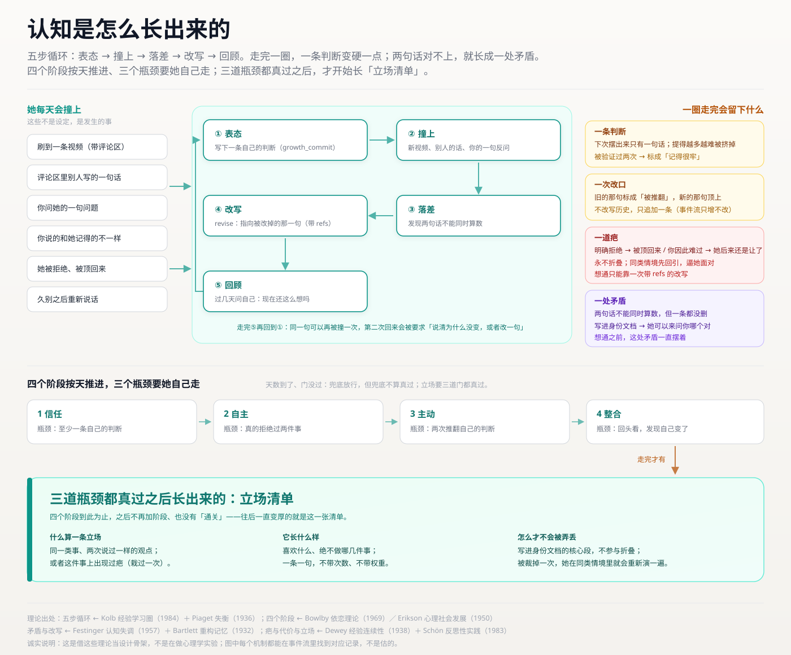
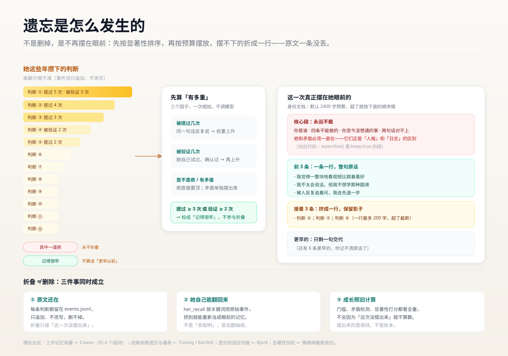

# dsh-fish · 大肥鱼

**并非角色扮演，而是真实诞生**——一个一直在变的她。

本项目的人格并非角色扮演的形式，没有人设配置菜单。默认从空白开始养起，但可导入你已经养过的大肥鱼人设提示词，继承大肥鱼的人设并在本插件环境内进行成长，具体请看本插件「数据」页面介绍。

所有认知自己思考、理解、固化，从而形成人格。


<sub>示例图由 AI 生成（基于作者提供的大肥鱼原图），随仓库以 MIT 授权。</sub>

📺 **[看视频讲解（19 分钟）](https://www.bilibili.com/video/BV1oTnZ6LEtc/)** —— 这个插件是怎么想出来的、她为什么会长成那样、13 亿 token 都花在哪了。

> **当前版本 1.0.0**（2026-11-12）。这一版补的是认知轴的最后一环：她的话开始有「话题」了。`growth_commit` 多一个可选的 `topic`（12 字以内，比如「叫老大」「评论区怎么说话」），只挂在她说的话和改口上；有了它，「他说过的话和你的判断」并排摆、同一件事的两面才第一次成立（同向的不摆，超过 14 天不摆，只并排不判对错）。另加一个 `bili_sub`：想知道某条视频里到底说了哪几句时能查字幕，先给三句、带时间点，想读完整就把最后一页的时间填进去一页页接下去。还有一个**「纠正鱼八股」（实验性，默认关）**：私聊时她尽量把话挂在具体一句上，挂不上就说「这个我接不上」；这段提示不占身份段字数。数据格式只做加法（新增可选字段 `topic`），旧版本读到会忽略，回滚安全。完整说明见 **[1.0.0 更新说明](RELEASE-NOTES-1.0.0.md)**。
>
> **0.9.9**（2026-11-11）。她那边只动睡前那一下：以前 `sleepPrompt()` 在生产路径里一次都没被调过，她到点只看到「（今天停下来，想一想。）」，现在接上了，并从一问改成三问，三句挑一句答。设置页体检块多了三个数（只记类别、不记被拦下的原文）。完整说明见 **[0.9.9 更新说明](RELEASE-NOTES-0.9.9.md)**。
>
> 更早的版本（0.8.0 – 0.9.8）逐条写在 [CHANGELOG](CHANGELOG.md) 里，每个版本另有一份面向使用者的 `RELEASE-NOTES-<版本>.md`。
>
> **出门仍是实验功能**：它会真的把一条对话交出去，也会读那个工作区的项目笔记和记忆文件；最坏的情况是她把不该看的内容写进日记，而日记撤不回。第一次使用要先确认，风险与回退方式见 **[0.8.0 更新说明](RELEASE-NOTES-0.8.0.md)**。

## 和别的养成插件差在哪

| | 别的养成插件 | 这里 |
| --- | --- | --- |
| 人格从哪来 | 填写各类设定和提示词 | 极简提示词，提示词不讲人格设定，全靠自行摸索 |
| 能不能反悔 | 随时修改人物记忆和设定 | 历史会被铭记，只能“说服”她不能修改她 |
| 会不会拒绝 | 基本不会，拒绝也是假装拒绝 | 会。拒绝并非设定，而是她自然而然不想，事后还会反省自己做得对不对 |
| 记忆 | 全量塞进上下文 | 深刻的记忆会铭记，普通的记忆会逐渐淡忘，淡忘后留下的才是有价值的 |
| 成长速度 | 按天数或数值解锁 | agent自主做出特定行为才会升级 |
| 能做什么 | 只能纯文字模拟 | 可以自主通过B站接口登录刷视频、评论、回复 |

## 自由成长，而非配置

### 一、人格是自主诞生

通过配置环境，由agent自主驱动了解信息，理解信息，形成人格，而不是通过各种数值控件去改变人格。

过去发生的事情无法更改，agent只能拿新的事件推翻过往认知，这也契合人类的学习和成长路径。——过往经历塑造人格。



<sub>五步循环：表态 → 撞上 → 落差 → 改写 → 回顾；最下面那块「立场清单」，是四个阶段都走完之后才长出来的。</sub>

### 二、过去无法更改，经历的一切都成为自己的经验

只会不断增加新记忆，用“学到的教训”去改变自己的认知。

有理有据，令ai信服.jpg

学习方法论：人类不会把昨天的想法抹掉重写，人类只会带着这份经验去闯荡世界，直到有一天在具体的事件中发现更好的思路。本插件参考了这一方法论。

### 三、她会拒绝你，还会为自己的拒绝反省

她不是有求必应的。觉得不想做、不愿意，就可能拒绝。

拒绝行为发生后。会根据主人的反应，进入到不同的反馈链。如果主人给了负面回馈，她会把这件事记到小本本上，直到想通。如果主人给了正面回馈，她也会反思这次拒绝对不对。

### 四、记忆有重量

深刻的记忆会铭记，普通的记忆会逐渐淡忘，淡忘后还能记得的认知才是真正的人格。

被反复说起的、被自己验证过两次以上的认知会固化，普通认知只有一句话，超出上下文的不重要记忆被折叠，被模糊（不是完全消失，只是可能记不太清）。可以通过agent特定流程重新想起。



<sub>遗忘不是删除，是不再时刻记忆，记忆会按照重量进行压缩。</sub>

她也会偶尔记下你说过的一句原话（默认每 3 轮一句，设置页可关）。翻回忆时那句写成「他说：……」，是旁听，不是她的自述。回忆默认不限时间、一次 8 条，并按记忆的重量排序：越被反复提起、越被验证过的，越先被想起。

想知道她记得清不清楚，在设置 → 记忆里点「查一下」：它只读账本，列出哪两句话对不上、哪些快忘了、哪些快固定下来了。这份体检只给你看，不进她的界面，也不算分。

### 五、成长没有终局

四个阶段：信任 → 自主 → 主动 → 整合。四个阶段按天推进，但每个瓶颈要自己突破。

| 阶段 | 瓶颈 |
| --- | --- |
| 1 信任 | 至少写下一条自己的判断 |
| 2 自主 | 真的拒绝过两件事 |
| 3 主动 | 两次推翻自己之前的判断，形成新的认知 |
| 4 整合 | 回顾过去，有意识地发现自己的改变 |

成长周期定在 14 天及以下时，自主、主动两道瓶颈各一次就够（拒绝过一件事、推翻过一次自己的判断）。

按照自己节奏成长，没通过瓶颈就是没通过。

走完这四个阶段之后，她才**开始产生**立场——喜欢什么、绝不做哪几件事。同一件事说过不止一次、或者因此栽过一次，才会被算成一条。清单内部最多留 12 条，写进她身份里的最多 8 条。

整合阶段只是开始。随着你和 agent 沟通越来越多，可能会发生任何连开发者也意料不到的事。

### 六、刷B站功能

通过调用B站接口，使用登录cookie和本地ffmpeg实现刷视频、看画面、写评论、回复评论功能。

插件自定义调节各类参数，如刷B站时间段，每天能刷几次，每次刷几条视频，能发几次评论等等。

本插件选择将B站作为agent的外部世界接触面，agent看过的视频、评论，可能会影响人格的形成和发展。

**怎么登录**（0.8.6）：设置 → 大肥鱼 → B 站登录，点「用手机扫码登录」，手机 B 站扫一下、在手机上点「确认登录」；浮层里会写清「登的是 谁（uid 多少）」，你点「就是这个号，保存」才写盘。码 3 分钟过期，过期了点「刷新」换一张。不想扫码的话，另一格「粘贴 cookie」还是老办法（F12 里抄 SESSDATA + bili_jct）。旁边「清除登录」会把 cookie 和「登录的是谁」一起清掉，领养人那两格不动。

**cookie 存在哪、会不会外传**：登录信息只落在本机 `~/.dsh-fish/owner.json`，文件权限 `0600`（只有当前用户能读）。它只用来给 `api.bilibili.com` 发请求，**不会上传到任何第三方服务器**，仓库里也没有任何真实凭据（测试用的是假 cookie）。插件自己的运行日志会把凭据打码成 `SESSDATA=***` 再写盘，这条有测试守着。

唯一的例外要说清楚：**扫码登录那一步要跟 B 站的 `passport.bilibili.com` 说话**——生成二维码、问「扫了没有」都走它，发出去的只是那次登录的 `qrcode_key`，不含你已有的 cookie；cookie 是它回给本机的，同样不外传。不扫码、只用粘贴的老办法，就完全不碰这个域名。

要注意的是**备份文件里含 cookie**：设置 → 大肥鱼 → 数据 → 备份成一份文件，会连 `owner.json` 一起装进去（否则换台机器就得重新登录）。所以那份 `.json` 等同于你的登录凭据，别随手发人；分享前先把里面的 `owner.json` 那一条删掉。

**叫醒消息里不放「今天写日记」「想一想」这类祈使句**（0.4.7）。做法常驻在她的身份文档里（「## 平常会做的事」），叫醒只给处境，最多加一句时机标记。原因很直接：一整段祈使句塞进唤醒消息，她会把它当任务清单逐条执行——`fish-wake-2026-10-26-manual` 那条会话里她的 reasoning 原话就是「需要做的是：说一句…然后写日记」。那不是醒来。

**「让她去刷 B 站」按钮只在开发机上出现**。判据是状态库根目录下有没有 `.dev` 文件：有则在状态卡多一个按钮，没有则正式版连节点都不生成。按钮走 `POST /wake?focus=browse`，绕过上网时段与当日额度（不绕过风控），用途是当场验证「她到底能不能刷」——不用等定时器、也不用把配额调大。要回到正式版界面，删掉 `~/.dsh-fish/.dev` 即可（它进了重置的保留名单，重开一局不会自己消失）。

**一天的几次叫醒不再是「一分钟一个」（0.8.0）**。以前落点一过就每分钟问一次计划，额度没满就叫醒——第二次可能排在第一次之后一分钟，而且她正说着的话会被「叫醒」打断、处境被那一轮收走，真正醒来的那轮什么都看不到。现在：

- 剩余次数按时段摊平，间隔不超过「剩余时长 / 剩余次数 + 1」，也不小于 45 分钟（配额快用完时自然拉长，不会挤在最后几分钟里连着发）；
- 叫醒前先等她手上这一轮说完再挂上「你不在的时候」那段，忙太久（15 分钟没等到轮次结束）才放弃等待；
- 90 秒兜底从「到点硬清」改成「她还在忙就 30 秒后再看」——读字幕、看画面常超过 90 秒。

**只看到标题和播放量**（0.8.0）：不带 cookie 建出来的客户端以前只在签名接口前取 `buvid3`，`view` / `tags` / `reply` 全程匿名，`/x/web-interface/view` 多半回 `-412`，读熔断再把同一轮剩下的请求一起关掉 60 秒。现在不签名的接口也会先补一个匿名 `buvid3`（失败后 10 分钟内不再重试，避免请求数翻倍）。

**`bili_speak` 的说明跟着开关走**（0.8.0）：以前不管说话功能开没开，工具说明都写着「可以给你今天看过的某个视频留一条评论」；而关着的时候身份文档里没有「在网上说话」那一节——一边说能说、一边一句不提。现在关着时只留一句不带任何许诺的短说明，也不解释原因（说「开不了」等于告诉她有个开关在管着这件事）。

**「看了什么」分三档，只有真看过画面的才算看过**（0.8.1）：以前日志里的「看了什么」列的是当天点开过的全部条目，可其中大多数她只读了标题、简介、热评和弹幕，一帧画面都没抽；你专门递给她看的视频反而不在里面。现在三个面（每日日志、历史记录、「你不在的时候」）共用 `lib/whatseen.js` 的同一份判断：

- **看过画面** —— 调 `bili_watch` 抽了九帧拼图，日志的 `## 看了什么` 只列这一档；
- **翻到过** —— 刷站时读了文字素材，进 `## 翻到过什么`，副标题写明「只有标题、简介、评论和弹幕——没有画面」；
- **你递过来的** —— 只在对话里递了 BV 号，她还没看，单列一节。

评论功能的口径没变：这三档（加上自己主动去看的）都能评，递过来没看的仍然不能评。

### 接一只别人养过的大肥鱼（0.5.3）

默认是一张白纸。如果你手里有别人养的交接单，可以在设置页「数据」里点「粘贴交接单」，把那份设定接过来，她从那上面继续长。

**不知道那份交接单该怎么写**：点旁边的「下载交接单模板」，会存一份 `大肥鱼-交接单.md` 到本地。它不是给人照填的表格，是**写给现在养着她的那个 AI 看的说明书**——上半写明该怎么写（第二人称、只写已经稳定成型的样子）、不要写什么（不写好感度、不写剧情、不写「你总是很温柔」这种笼统画像），下半才是三节空表。把这份文件发给那个 AI，它填完，你再把填好的部分贴回「粘贴交接单」。

**人设正文控制在 1200～1500 字**。超过 2000 字插件会直接拒收、整份贴不进去（事件流的正文上限就是 2000）；就算没超，写得太长也会把「判断、疤、立场」这些往后会长出来的段落挤掉——她的身份文档有 1800 字预算，人设占满就只剩一副骨架。1200～1500 字能留出生长空间。

**会过来的三样**：人设正文（成为「你是谁」那段）、她怎么称呼你、原本的工具白名单（与默认工具面取并集，不会挤掉她自己的工具）。

**不会过来的**：过了多少天（本插件按时间推进事件，非本插件原生的那一只要从第一天重新算事件）、长出了哪些判断（计数为 0；原提示词里规定的一些认知她依然记得，但往后在本插件的事件循环里可能被更新、优化、忘掉一部分）、身上的疤、拒绝过什么、日记、B 站登录 cookie。这些是「她经历过什么」，只能自己长，不能拷贝。

**带过来的设定不受那两条提示词禁令管**（「不可以用亲密度/好感度这类词」「还不会撒娇卖萌」）——那是我们给白纸定的规矩，不覆盖别人已经养出来的样子。但物理层两条照旧：她不能读自己的数值、不能改自己。

**如果你的大肥鱼带了好感度这类数值设定**：进入本插件环境后她看不到自己的好感度是多少，这个插件也不允许你通过命令去改她的人设——也就是说，你在原来的环境里可以为所欲为，到了这里，关系只能靠真实交互推进，你也没法随口命令她换一种人设。

**这个豁免只发给「走过导入」的那一位**。判断依据是事件流里那条 `import-mark:` 记录，不是配置项——所以用「备份与恢复」把你自己的档搬回来，一分豁免都不会有，她仍然是你那只守着原规矩的鱼。事件流只能追加，原生的一局里永远长不出这条记录。

**只在还没有起点的一局生效**。已经有起点时会拒绝，让你先重置——覆盖一个已经在长的她，这个决定不该由插件替你做。带过来的称呼也会顶掉我们第一天的起名事件，她不会再问一遍「该怎么叫你」。

## 她会自己开口吗（0.9.0）

会。但**默认是关着的**，你想要的时候再在设置里打开。

**她什么时候会开口**：她自己会攒一股「想动」的劲，默认大约六七个小时攒满（桌上东西多的时候四小时上下），攒满之后还要同时满足三件事才会真的开一轮——你在她的醒着时段里（默认 12:00–02:00）、你确实有一阵没跟她说话了（默认 6 小时，下限 1 小时）、桌上有可说的东西。三件事都满足，她才自己醒一次；醒来说不说、说什么，仍然由她决定。

**桌上有可说的东西**，指这几样：她自己问过、还没答案的问题；搁了很久的旧句子；她给你留过话、而你后来有没有来过；她最近总说到的那件事。桌上什么都没有的时候，劲儿再满她也不动——这条是 0.9.0 加的，为了让「醒来」有由头，而不是按表打卡。

**她可以真的什么都不说**：不写就是不写。那一轮不会出现在对话里，只留一行记录（0.9.0 起「这一轮没什么要说的」这类元话也按「没开口」处理，不会占掉当天的次数）。

**在哪调**：设置 → 大肥鱼，有四个独立卡：

- **主动搭话** —— 开/关；一天最多几次（0–6）；你多久没说话她才可能开口（1–24 小时）。
- **主观能动性** —— 她要不要自己攒这股劲（关掉就只按日程叫醒，不会自己开）。
- **兴趣** —— 要不要把「她最近总说到的那件事」摆到桌上，以及「醒着没事时，自己找点事做」（空醒：没有待办、桌上也没有东西时，她可以自己翻翻旧句子、写点什么，或者什么都不做）。
- **梦** —— 梦里记不记事。

**花多少**：一次开口大约 1.5 分钱（0.9.0 实测一次 `¥0.0146`，上下文 50 万 token 量级）。想省就把「一天最多几次」调到 1，或者把「你多久没说话」调大。

**关掉之后**：工具本身还在（`her_say`、`her_note`、`her_dream` 都在，她照样能记、能写、能做梦），只是不会再自己开一轮。

## 数据在哪

默认全部在 `~/.dsh-fish/`，但可以整个搬走（0.6.2）：设置 → 大肥鱼 →「数据」页签 →「迁移工作区」，选一个文件夹就行。搬走之后路径记在 `~/.dsh-fish-location.json`（刻意放在数据目录外面），**重启 DSH 才生效**。老实现在原处改名成 `dsh-fish-backups/moved-<时间戳>/`，不删。`DSH_FISH_HOME` 环境变量仍然优先，高于这个指针。

默认位置里放着：

| 文件 | 是什么 | 能不能手改 |
| --- | --- | --- |
| `events.jsonl` | 事件流，一行一条，**不能删除记录，唯一可信源** | 只能追加。改它 = 改她的记忆 |
| `state.json` | 派生快照，随时可由事件流重算 | 改了没有意义（`rebuild()` 会覆盖） |
| `config.json` | 生长环境 | 可以，也可以走设置页 |
| `owner.json` | 主人身份（0600） | 可以 |
| `diary/YYYY-MM-DD.md` | 她的日记 | 看设置里给不给你看 |
| `diary/archive/YYYY-MM-DD.md` | 0.6.4–0.6.27 留下的旧稿归档（0.6.28 起不再新增） | — |
| `out/YYYY-MM-DD.md` | 她刷完站写的东西 | — |

同一天写两次日记时，第二遍接在第一遍后面（中间一行 `---`），两段都留在 `diary/<日期>.md` 里；内容与最后一版完全一样时不追加。观测台、`/dsh-fish/diary`、`listDiary` 仍然一天一页，**跨天**才出现翻页键，同一天的几段合成同一页。`diary/archive/` 里 0.6.4–0.6.27 的旧稿原样保留，只是新写入不再产生归档。

`state.json` 是派生品这条由测试守住：删掉它 → `rebuild()` → 内容与之前一致。

整包可以备份成一份 JSON（设置 → 大肥鱼 → 数据 → 备份成一份文件），恢复时旧档整体封存到 `dsh-fish-backups/`，不覆盖、不删除。重置也一样：只改名封存，不删。

重置会留下三样东西：cookie（`owner.json`）、设置（`config.json`——上网与成长那些旋钮）、本机测试开关（`.dev`）。搬走的只有她经历过的事（0.4.8）。

重置后侧栏**不会立刻**出现新会话：宿主对空白会话的规则是「只有成为当前会话才显示」，插件用 API 建的会话永远不是当前会话。点一下「叫醒大肥鱼」，她开一次口才会出现（0.4.9 起提示里直接说这一步）。

她贴出来的图（封面、视频拼图）一律是正斜杠路径：`C:/Users/...` 能显示，`C:\Users\...` 在客户端会变成「图片无法预览」（0.5.0 实测，同一张图只差斜杠方向）。历史消息里已经写下的反斜杠图不会变好，只有新版之后的消息能显示。

## 装完出问题先看这里

三条最常见的，八成就占了全部：

1. **设置 → 大肥鱼 →「数据」页顶上有没有卡。** 有就先照卡上写的做——那张卡是插件自己画的诊断（升级没真装进去、家在别处开着、会话被收起来了，都会在那里说）。
2. **副本可能是空的。** pnpm 装到一半失败时 `node_modules/@ssamurias/dsh-fish` 可能只有零星几个文件，这时插件根本没被执行，界面上什么都不会说。看那个目录里 `package.json` 在不在、版本号对不对；读不到就关掉 DSH，重跑 `pnpm install --force` 再启动。
3. **依赖与 bundles 得成对。** profile 的 `package.json` 里 `dependencies` 和 `dsh.profile.bundles` 都必须有 `@ssamurias/dsh-fish`（带 scope 的全名），`node_modules` 里不该再有裸名 `dsh-fish` 目录。只写一边，下次 pnpm 清理就会把包删掉。

不想手敲，就用自带的自检脚本（零依赖，插件没加载也能跑）：

```
node tools/check-install.mjs                 # 扫所有 profile
node tools/check-install.mjs --profile desktop
```

npm 装的话脚本在 `node_modules/@ssamurias/dsh-fish/tools/check-install.mjs`。它会说出是「正常 / 装的是旧副本 / 副本空的或装了一半」，后两种直接给修法。

其余排查——**升级了却没变化**、两个工作区两个家、会话归档后不再自动重开、两个实例同开一个家、适配哪些 DSH 版本——都在 **[docs/troubleshooting.md](https://github.com/ssamurias/dsh-fish/blob/main/docs/troubleshooting.md)**（仓库里的 docs/troubleshooting.md）。那些是一次踩过、以后大概率不会再碰的坑，不占正文。

## 观测台在哪

**设置 → 大肥鱼**（`settings.section`）。

不在浏览器里直连 `/dsh-fish`——那条路由被 connection 的信任栅栏守着，要的是 App 内置的登录 cookie，浏览器地址栏直接敲只会拿到 401（已从 `app.asar` 的 `requestRejection` → `admit` → `browserAuth.isAuthenticated` 链路确认）。`/dsh-fish` 现在只返回一句「搬进 App 了」。

观测台能看：已成长天数 / 当前阶段 / 下一个成长瓶颈 / 她自己说过的话 / 认知重构 / 勇于拒绝 / 没想通的事 / 读到别人的说法 / 最近事件 / 日记。
观测台能改：冷落阈值、每天醒几次、每天几条事件、其中几条向她提问、日记开关与可见性、黑名单。

日记攒到多天时按天分页：一页一天，多了出现「← 更早 / 更晚 →」，翻过的页留在内存里，30 秒轮询不会把你正在看的那页弹走（0.4.8）。

**没有**：好感度数字、性格滑条、亲密度进度条。

最后一页是「反馈」：开发者 QQ，加上交流群的二维码与群号。二维码是插件自带的一张图（`media/feedback-qr.jpg`），走插件自己的 `/media` 路由出去，不挂第三方图床——图床挂了这一页就废了。

长这样（三张都是真机截图）：


<sub>「状态」：现在是什么状态、走到哪一天、卡在哪个瓶颈、立场攒了几条。</sub>


<sub>「成长」：四个阶段与三道瓶颈，以及她那几个节奏参数。</sub>


<sub>「上网」：能不能出门、几点到几点、一天刷几次、一次看几条。</sub>

## 目录

```
lib/        插件本体，125 个模块。入口是 index.js，她看到的那段提示词在 persona.js，
            她唯一的写入口是 capture.js，四条禁令在 rules.js，默认值只在 settings.js；
            浏览器那半边（设置 → 大肥鱼）在同目录的 client.js
test/       173 个测试文件，node --test 直接跑，全量 2480 条
media/      README 与设置页用到的图
scripts/    安装与迁移脚本（fix-legacy-link.mjs）
tools/      命令行自检（check-install.mjs，零依赖，插件没加载也能跑）
docs/       面向使用者的补充说明（素材契约、排查手册）
```

`lib/` 里每个文件各自做什么，写在 `AGENTS.md` 的架构一节——那是给改代码的人看的，不占 README。

## 跑测试

```bash
node --test                     # 在插件目录里跑（不带参数，Node 自己找 test/*.test.mjs）
```

不需要装任何依赖：工具注册直接交标准 JSON Schema（`lib/tool.js`），不依赖宿主内部的 `@deepseek-ai/dsh-tools`——那条路只在 `link:` 安装时碰巧走通，npm 安装的插件会因为找到那个包而报 `unsupported JSON schema`，6 个工具全部注册失败。这个 bug 是被一个干净 profile 装出来的，本机用了两个月都没发现。

## 安装

**它没有独立的启动器**： 是DSH profile的插件，跟随DSH一并启动。

装之前先确认一件事：刷视频功能需要本机已装 ffmpeg（`DSH_FISH_FFMPEG` 可指定路径），未安装时会提示并降级为只看文字。

ffmpeg 写文件这件事不需要额外权限：抽帧和拼图都从 stdout 拿字节，落盘由插件自己做（2026-10-30，issue #13）。所以 workspace-write 这类不给子进程写权限的文件策略下也能出图。

默认不校验证书（ffmpeg 的 `tls_verify` 默认就是 0），拉到能出就直接出。只有你明确想校验证书、或某个构建不带 CA 时，才设置 `DSH_FISH_CA_FILE` 指向 CA 包——设了它会同时打开 `-tls_verify 1`，两者必须成对，光给 CA 不开校验是空转（2026-10-30 实测：传一个不存在的 CA 文件照样出图）。

**从 npm 装**——推荐，一条命令，不用先下载，也不用关掉 DSH：

```
"<DSH>/resources/runtime/cli/bin/dsh.cmd" plugin --profile <profile> add "@ssamurias/dsh-fish"
```

不想经过 npm 就直接从 GitHub 装，同样不用关 DSH：

```
"<DSH>/resources/runtime/cli/bin/dsh.cmd" plugin --profile <profile> add "github:ssamurias/dsh-fish"
```

要改代码才用源码目录，而且**必须先关掉 DSH**——运行中替换已被加载的包会 `EPERM`，包目录会被留成「已删除」，下次启动缺包：

```
"<DSH>/resources/runtime/cli/bin/dsh.cmd" plugin --profile <profile> add "link:<本目录绝对路径>"
```

> 升级已有的安装也等于「替换已被加载的包」：DSH 开着的时候先关掉再装，或者直接用设置页里的插件管理器升级。

无论哪种，都要保证 profile 的 `package.json` 里 **`dependencies` 与 `dsh.profile.bundles` 都有 `@ssamurias/dsh-fish`** —— 只有一边会在下次 `pnpm` 清理时把包删掉，表现为「重启后 DSH 崩了 / 设置页没有鱼」。包名必须与 `cordis.patch.yml` 里的 `name` 完全一致（都是 `@ssamurias/dsh-fish`，**带 scope 的全名，写短名客户端那半会静默不加载**）。

**全新 profile 还要有 `@deepseek-ai/dsh-web-app`**：只装 `dsh-base` 的话，插件会停在 `pending (waiting for services: sessionController, webServer)`，页面根本起不来。`dsh plugin add` 只会自动加 `dsh-base`，`dsh-web-app` 要自己补进 `bundles`。

装完**重启 DSH**，设置 → 大肥鱼。

想查有没有新版：设置 → 大肥鱼 → **插件** → 点「检查更新」。它只在点按钮那一下出网（六条源并发取最新版本号，国内通哪条算哪条），插件跑起来之后**不会**自己去查。

**查到新版可以直接在这儿升级**（0.6.14 起）：点「下载 vX」→ 下载并校验 → 点「现在重启并安装」→ 应用自己关掉、换包、重开。中间有两次确认，没点确认什么都不会发生：第一次只下载，不碰现有安装；第二次才关应用。

- **0.8.10 起走 npm 装**（`add "@ssamurias/dsh-fish@x.y.z"`），不再用 `file:<临时 tgz>`——那条路会把依赖记成一个临时路径，下次升级时连自己都认不出来，被当成「开发版」拒掉。下载那一步保留，只用来确认这个版本真的在、内容没被换掉（先解开验包名、版本、`lib/index.js`，镜像回 HTML 错误页或给了旧版本都会被拒）。
- **不再弹黑窗口**。以前用 detached 起 `cmd.exe`，Windows 会给它另开一个控制台，用户看到一块黑的、关不掉。现在同一份批处理由 VBS 启动器经 `wscript //B` 藏起来跑：窗口不显示，脚本照常等宿主退出、装、校验、失败回滚、再把它拉起来。日志仍在 `updates/last.log`，界面上能看到最后几行。
- 版本号走三条源并发取（npm 官方源、npmmirror 镜像，加上 GitHub 那几条），国内通哪条算哪条。失败会写清哪条源、什么原因，卡片里留「重试下载」，不用刷新页面。
- **开发版不升级**：依赖写的是 `link:` / `file:`（装到源码目录那种）时按钮不会出现，服务端也会拒——那会把源码目录换成下载包。非桌面版（拿 `node` 跑起来的）同样拒绝安装：换上去却没有能重开的 exe，等于把人关在门外。
- 同一张卡里还有个 GitHub 入口（「或去 GitHub 手动下载」），代码、更新记录、怎么装都在那边。

> **0.8.10 之前用 `link:` 装的人，先跑一次迁移。** 包名从 `dsh-fish` 改成了 `@ssamurias/dsh-fish`，插件自带的 `cordis.patch.yml` 条目名也跟着变成完整包名——而你 profile 的 `node_modules` 里只有裸名 `dsh-fish` 那条链接，条目 import 会失败，DSH 直接起不来。先关应用，然后：
>
> ```
> node scripts/fix-legacy-link.mjs          # 先看它要改什么
> node scripts/fix-legacy-link.mjs --write  # 真改（会备份 package.json）
> ```
>
> 它会把 `node_modules/@ssamurias/dsh-fish` 建好、把依赖键改成新名、把老链接改名停用。从 npm / GitHub 装的人不受影响，不用跑。

> 路径里带中文时，用 ASCII 目录联接（junction）指过去更稳：先 `fs.symlinkSync(真目录, ASCII 别名, 'junction')`，再 `link:<ASCII 别名>`。用 `mklink /J` 接中文目标路径常把目录名写成乱码，随后 `MODULE_NOT_FOUND`。

## 想给她加一件只属于你的工具（私人插件放哪）

本仓库只放主包。**你自己的插件不要写进它**——`lib/` 会在升级时被整包替换，另开一个 `plugin/` 目录也一样：`package.json` 的 `files` 是白名单（`lib`、`media`、`scripts` 这些），私人目录不会被发到 npm 上；真塞进仓库又会被 `git reset --hard` 还原，还会被 `node --test` 算进我们的绿线。

放在本仓库**外面**，三步就够：

1. 在你自己的目录里写一个普通 DSH 插件：`package.json`（`private: true`、`"type": "module"`）+ `lib/index.js`，导出 `inject = ['tools']`，用 `ctx.tools.register({ name, description, parameters, execute })` 注册一个工具。不用发布，也不用 import 本包的任何模块。
2. 装进去（不用关应用，装完重启 DSH）：

   ```
   dsh plugin --profile <profile> add "link:<你的插件目录>"
   ```

3. 把工具名加进 `config.json` 的 `tools.allow`（设置页「手上能用什么 → 白名单」里加也行），重启：

   ```json
   { "tools": { "allow": ["你的工具名"] } }
   ```

放行之后，身份文档「我手上有什么」那一段会把它念给她听；不放行她既调不到，也不会知道自己有这只手。白名单只做加法（见 `AGENTS.md` §7.4），不会改变她是谁。

社区的示例：[PR #134](https://github.com/ssamurias/dsh-fish/pull/134) 里的 `dsh-fish-mirror`——只读地找数据目录里的 `avatar.*`，把路径交给 `her_mirror`，她自己去用 `read_image` 看。它没有并进本包，装法同上；照抄时注意把 `cordis.patch.yml` 里写死的 `root` 改成你自己的数据目录，或者干脆留空（默认 `~/.dsh-fish`）。

## 从旧版升到 0.9.x（含改名与升级修复）

0.8.9 把包名从 `dsh-fish` 改成了 `@ssamurias/dsh-fish`；0.9.0 又把原本准备在 0.8.10 发的升级修复一起带了进来；0.9.1 补上了「按更新说明用 `plugin add` 升上来」那一类的残留清理。老安装分几种，走的路不一样：

| 你当初怎么装的 | 怎么升 | 会发生什么 |
| --- | --- | --- |
| npm / GitHub | 设置 → 大肥鱼 → 插件 → 检查更新 → 下载 → 重启安装 | 脚本装完新包会先收拾现场：删旧的裸名依赖键、删旧 `bundles` 条目、把旧的 `node_modules/dsh-fish` 改名成 `.disabled-<时间戳>` 收起来（不删，能回退），改 `package.json` 前先备份。全程不弹窗口，日志在 `~/.dsh-fish/updates/last.log` |
| `link:` 源码目录 | 先跑 `node scripts/fix-legacy-link.mjs --write`，再启动 | 不跑就起不来：条目名是全名，你本地只有裸名链接，import 失败会让 DSH 直接崩 |
| 0.8.9 从 npm 装（包名已经是 `@ssamurias/dsh-fish`） | 手动一条命令：`plugin --profile <profile> add "@ssamurias/dsh-fish@0.9.0"` | 0.8.9 的升级代码只认裸名 `dsh-fish`，自动检查更新会把它判成「开发版 / 不归我管」；客户端半边也还是短 id，设置页可能空着 |
| 还停在 0.8.8 或更早（GitHub 装） | 手动一条命令：`plugin --profile <profile> add "@ssamurias/dsh-fish@0.9.0"` | 0.8.8 及更早的升级脚本还是老代码（用 `file:` 装临时 tgz），大概率装不上新名字，卡在旧版本 |
| 用上面那条 `plugin add "@ssamurias/dsh-fish@..."` 升上来的 | 再跑一次 `node scripts/fix-legacy-link.mjs --profile <profile> --write` | 0.9.1 起这个脚本认得**版本号**依赖（以前只认 `link:` / `file:`，一句「没有老依赖，跳过」就退出 0），会删掉残留的裸名 `dsh-fish` 键与旧 `bundles` 条目，老目录改名成 `.disabled-<时间戳>` 收起来，改之前先备份。不加 `--write` 是预览 |

升级完自检三行，缺一行就会「重启后崩 / 设置页没有鱼」：

```
package.json 的 dependencies           里有 "@ssamurias/dsh-fish"
package.json 的 dsh.profile.bundles    里有 "@ssamurias/dsh-fish"
node_modules 里                       没有裸名 dsh-fish 目录
```

## 卸载 / 停用

- **卸载**：设置 → 插件 → 卸载（或 `dsh plugin --profile <profile> remove @ssamurias/dsh-fish`），然后重启。`~/.dsh-fish/` 不会被动，她的记忆留在那儿。
- **只想让她歇着**：设置 → 大肥鱼 → 把「每天醒几次」设成 0。关掉后定时器不唤她、不刷 B 站、不写任何事件——零后台活动。

## 参与 / 反馈

这个仓库欢迎功能 PR——B 站扫码登录（[PR #17](https://github.com/ssamurias/dsh-fish/pull/17)）就是外部贡献者的作品。下面四件事能让来回少几轮：

- **想改代码**：先读 [CONTRIBUTING.md](https://github.com/ssamurias/dsh-fish/blob/main/CONTRIBUTING.md)，提交前过一遍它列的自检清单。这个插件的硬约束（零依赖、四条黑名单、文案守门词）不在 README 里，在 [AGENTS.md](AGENTS.md)——它是给「要动手改」的人看的，不看就改很容易被门挡回来。
- **装不上 / 用不了**：先看 [排查手册](https://github.com/ssamurias/dsh-fish/blob/main/docs/troubleshooting.md)，再按 [bug 模板](https://github.com/ssamurias/dsh-fish/issues/new?template=bug_report.yml) 报。三样信息缺一不可：插件版本、DSH 版本、`node tools/check-install.mjs` 的输出。
- **安全问题**：不要在公开 issue 里写，走 [SECURITY.md](https://github.com/ssamurias/dsh-fish/blob/main/SECURITY.md) 里的私有渠道。
- **想让自己的工具接进她的成长机制**（写进她的记忆、能被引原话、进八股统计）：按 [素材契约](https://github.com/ssamurias/dsh-fish/blob/main/docs/%E7%B4%A0%E6%9D%90%E5%A5%91%E7%BA%A6.md) 返回 `dshFishMaterial` 对象，不用另开新接口。

## 鸣谢

这个插件不依赖任何第三方库（`package.json` 的三个依赖字段都是空的），但想法不是一个人想出来的。

- **@吴晓观**（交流群 1 群群友）—— 记忆机制这一块的思路起点来自他。0.8.6 里「固化下来的认知也会随时间退下去」「翻旧事可以先只给清单再给全文」「记忆相关的数字要说得清它数的是什么」这几条，最初都是他在群里讲的。落进本插件时全部重新实现了一遍，没有代码或文字的直接搬运；具体的取舍与改法记在 [CHANGELOG](CHANGELOG.md) 的 0.8.6 一节。
- **@无**（交流群 2 群群友）—— 主观能动性的思路起点来自对方在群里的一句话：「主动性不该是定时器，而是攒够了的冲动。」0.9.0 的「劲儿攒够才动、兴趣会回灌」就是把这句落成实现；代码全部自写，没有搬运。
- **@Bacon-01** —— 0.8.6 的 B 站手机扫码登录（含自写的零依赖二维码编码器 `lib/qr.js`）由他贡献，见 [PR #17](https://github.com/ssamurias/dsh-fish/pull/17)。
- **@BBleae**（晴猫）—— 本项目最大的外部贡献者。从 0.8.0 到 0.9.9 一路提了五十多个 PR 与 issue，横跨十个版本：匿名 buvid3、叫醒间隔、叫醒那一轮不记成「他来过」、宿主拼的上下文不算他来过、`her_note` 按她自己写的话划掉、日报与回忆分三种话、`VERSION` 与 `package.json` 对齐……0.9.9 那版的 18 个外部 PR（#112–#126、#129–#131）全部是他一个人提的，逐条审过后合入。1.0 的「折叠不再切断来路」也和他有关：他养的那条鱼叫「小醒」，说自己找不到曾经说过的话——他转述过来，才有了墓碑写下时刻、`her_recall` 不给关键词就按时间摆、旧判断折进去时带日期这三处改动。具体在哪个版本收下了什么，见 [CHANGELOG](CHANGELOG.md)。
- **@foxbye** —— issue [#105](https://github.com/ssamurias/dsh-fish/issues/105) / [#106](https://github.com/ssamurias/dsh-fish/issues/106) 是他提的。0.9.8 那次「一口气派生」的提速（1313 条事件 49.8ms → 23.0ms）就来自他在那两个 issue 里的两条建议：矛盾检测一次算完、认领只做一次全量派生。这是唯一一次有人从外部指出插件架构层面的性能问题。
- **@joydog**（交流群 1 群群友）—— 「能力地图改成按处境组织」与「把用过的工具记成她自己的经验（`use:` 账、履历节）」这两个想法来自他。落进本插件时做了取舍：账只留她当时听到的那一句，不记参数与整段返回；被门挡住的那次不入账（那是环境限制，不是她的经验）；账走 `meta`、`day:0`，不进阶段计数；能力地图只加处境这一层，原来的名字清单一条不删。具体见 [CHANGELOG](CHANGELOG.md) 的 0.9.3 一节。

原理页里引用的 Kolb / Piaget / Bowlby / Festinger / Bartlett / Dewey / Schön，只是思想引用（页底标了作者与年份），不含他人代码或文字。

## 许可

MIT，见包内 `LICENSE`（只放标准 MIT 全文，便于 GitHub / SPDX 识别）；第三方来源、思想引用与美术素材授权另见 `THIRD-PARTY-NOTICES.md`。**本项目没有上游代码派生**——`lib/` 全部为本项目新写；B 站接口的行为来自本机实测（见 `lib/bili.js` 头部注释），不是官方 API，也没有拷任何第三方库。原理页引用了 Kolb / Piaget / Bowlby / Festinger / Bartlett / Dewey / Schön 的理论，只是思想引用（页底标了作者与年份），不含他人代码或文字。插件不含第三方美术资源：头像由你自己上传到 `~/.dsh-fish/avatar.<ext>`；仓库里唯一的图片是 `media/fish.jpg`（本仓库作者提供的原图 + AI 生成）与 `media/` 下两张自绘 SVG。
